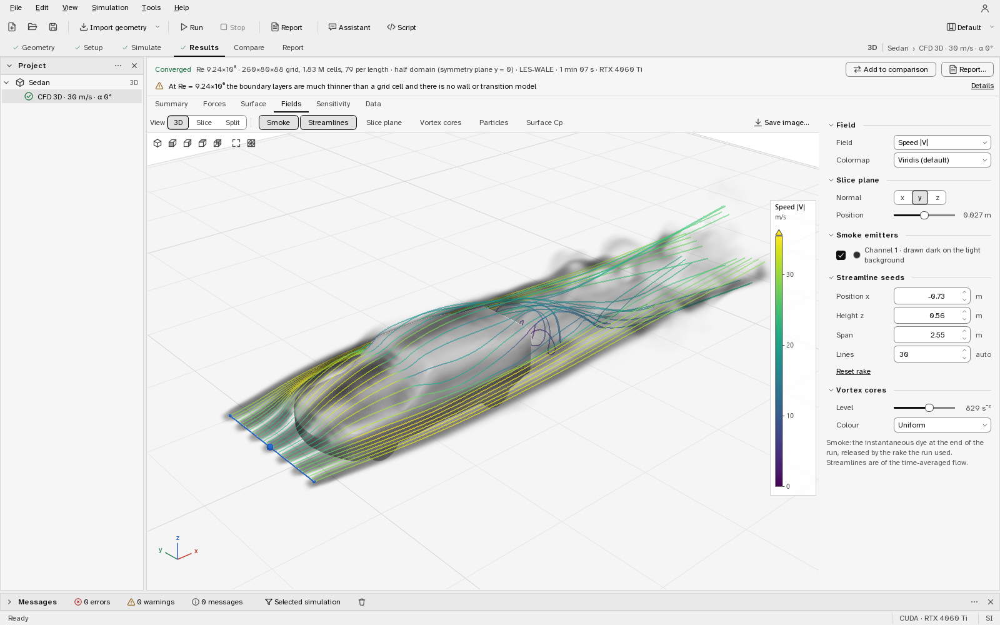
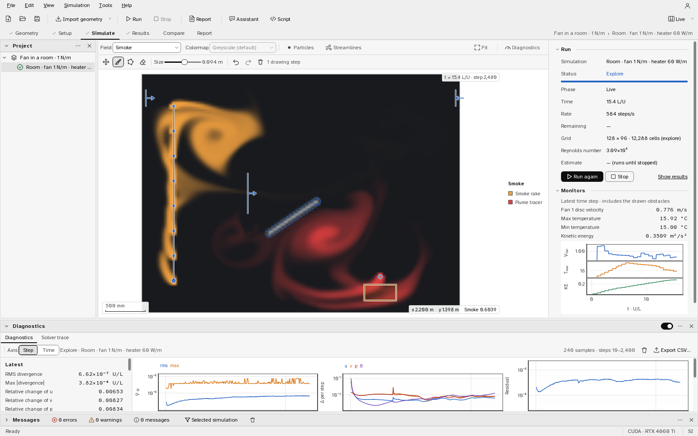

# Aerolume

Aerolume is an open-source desktop studio for aerodynamics and heat transfer, in 2D and 3D.
It runs incompressible Navier–Stokes solvers written in PyTorch on an NVIDIA GPU or on the
CPU, an XFOIL-class airfoil solver and finite-wing analyses, and wraps them in one guided
workflow: **Geometry → Setup → Simulate → Results → Compare → Report**. Smoke emitters, heated
bodies, heaters, fans, jets and closed rooms can be placed into any simulation; obstacles can
be drawn into a running flow; every run carries its solver diagnostics. It is built for
independent student researchers, and anyone else who needs numbers they can defend: every
solver is checked against published benchmarks, and every result comes with its error bars
and its limits stated next to it.



Licence: Apache-2.0. Version 0.1.0, the first public release (1 November 2026); see
[CHANGELOG.md](CHANGELOG.md). Developed and tested on Windows 11 with an
NVIDIA GPU; every feature also runs on the CPU. Linux and macOS have not been tested yet.

## Download and install

**Windows installer.** `Aerolume-0.1.0-cuda-setup.exe` installs the program for the current
user (no administrator rights): Python, PyTorch with the CUDA libraries, VTK, Qt, the
documentation and the validation scripts are inside, so nothing else is needed but an NVIDIA
driver for GPU runs (without one everything runs on the CPU). It adds a Start-menu entry, opens
`.aerolume` projects by double-click and uninstalls from Windows Settings. The installer is
not code-signed yet, so SmartScreen asks once. Download it from the
[v0.1.0 release](https://github.com/TanmayPasula/Aerolume/releases/tag/v0.1.0) (1.94 GB;
SHA-256 `72323e99690b860b7077994258082c34a76ec5f005a668c3ed9c4ebbdda0f2b1`), or build it
from this repository with one command (Inno Setup 6 and PyInstaller needed).

```bash
python packaging/build.py --variant cuda     # portable folder + headless smoke test + installer
python packaging/build.py --status           # does the existing build match the sources?
```

**macOS.** No `.app` has been built or tested yet: PyInstaller cannot cross-build and the
release is made on Windows. The same spec makes `dist/Aerolume.app` (a `BUNDLE` target with an
`aerolume.icns` icon generated from the app's SVG) when `pyinstaller packaging/aerolume.spec`
runs on a Mac; see [Building the macOS app](docs/install.md#building-the-macos-app).

**From source** (Python 3.11 or newer; keep the virtual environment outside cloud-synced
folders, the CUDA build of PyTorch is several GB):

```bash
git clone <repository URL> aerolume
cd aerolume
python -m venv .venv
.venv\Scripts\activate                       # Linux/macOS: source .venv/bin/activate
pip install torch --index-url https://download.pytorch.org/whl/cu130   # or .../whl/cpu
pip install -e ".[dev,ai]"
aerolume-cli doctor                          # versions, devices and a one-second solver check
aerolume                                     # the desktop application
```

[Installing Aerolume](docs/install.md) covers both ways, the portable folder, the self-test
(`Aerolume.exe --selftest`) and troubleshooting.

## What it does

**Navier–Stokes in 2D and 3D.** Incompressible flow on uniform staggered grids, the same code
on GPU or CPU: third-order upwind advection, SSP-RK3 time stepping, an exact FFT/DCT pressure
projection, LES closures (Smagorinsky, WALE, Vreman), CUDA graphs. Bodies are immersed by
volume penalisation, so any outline or surface mesh runs without meshing: airfoils,
multi-element wings, 2D vehicle profiles and 3D cars on a moving road with rolling wheels,
STL / OBJ / PLY meshes, bluff bodies. A symmetric 3D body is solved on a half domain. On the
development GPU (RTX 4060 Ti) the 2D solver runs 493 steps per second on 1024 × 512 cells and
the 3D solver 54.7 steps per second on 4.2 million cells.

**Heat, smoke, fans and rooms.** Any simulation can hold placed physics, in 2D and 3D alike:

* smoke emitters (points, rakes, lines, rectangles, discs, planes; up to four colours; pulsed
  for timelines) and GPU tracer particles;
* heat transfer with Boussinesq buoyancy: bodies held at a temperature, releasing a heat flux
  or adiabatic, domain walls likewise, volumetric heaters; the result gives the temperature
  field and every body's heat rate and Nusselt number with a standard error;
* fans as actuator discs set by thrust, pressure jump or a target speed the solver regulates,
  with a report of delivered thrust, volume flow and ideal power;
* jets and vents, hot or cold, carrying smoke;
* closed boxes instead of a wind tunnel: rooms, electronics enclosures, cavities.

The planner chooses the temperature and speed scales, states Ra, Gr, Pr, Ri and Pe with the
rule behind each, and warns about what the grid or the model cannot carry.


**Explore: drawing into a running flow.** Explore mode runs the flow continuously while you
change the angle, the speed or the Reynolds number, draw and erase obstacles with a brush or a
polygon, and drag emitters, fans, heaters and jets to new places. The Diagnostics panel shows
what decides whether a run can be trusted: the divergence after the projection, the change of
each field per step, the CFL number and time step, the pressure-solve residual and the
throughput, exportable as CSV. A solver trace captures one time step stage by stage
(tentative velocity, its divergence, the pressure correction, the corrected field). Production
runs record the same diagnostics and can use a PID-controlled time step.



**Airfoil polars and finite wings.** A panel method coupled to an integral boundary layer with
e^N transition (vendored mfoil by K. Fidkowski, with robustness patches) gives polars at flight
Reynolds numbers in seconds; it agrees with XFOIL 6.99 to 0.012 in c<sub>l</sub> on identical
coordinates. Finite wings run a vortex lattice or a nonlinear lifting line on the section
polars: lift, induced and profile drag, span loading and the stall-onset estimate.

**Runs that know when they are done.** The runner finds the end of the start-up transient from
the data, stops once the mean coefficients (or the Nusselt number) are known to the quality
preset's tolerance, and reports a run that misses it as *not converged* with the uncertainty it
did reach. Grid studies give a Roache grid-convergence index. Results export to CSV, NPZ and
VTK (ParaView); reports to PDF and HTML with the methodology and the validity of every number.

**Scripting, the Assistant and MCP.** `import aerolume as al` is the same API the program uses:
build designs, run and sweep simulations, plot and export. The in-app Script console runs it
against the open project. The experiment Assistant plans, runs and analyses experiments from a
goal in plain words, with Claude (an API key) or a local model through Ollama; every suggested
change is a card that changes nothing until you apply it, and nothing leaves the computer
without your consent. `aerolume-mcp` exposes the API to Claude Desktop or Claude Code over the
Model Context Protocol, so their model plans and Aerolume runs the physics on your computer, with
no API key in Aerolume ([docs/mcp.md](docs/mcp.md)):

```bash
claude mcp add aerolume -- aerolume-mcp --project "Wing study.aerolume"
```

**Accounts, optional.** The program works fully offline with no account. Connecting a Supabase
project of your own adds sign-in, cloud copies of projects with conflict detection, and
expiring read-only share links; the database migrations with row-level security ship in
`supabase/`. Nothing is configured or sent by default.

## Quick start

1. Start Aerolume and pick a study on the Start page: an airfoil, a 2D vehicle, a 3D body from
   a mesh, a wing, a heated room (3D) or an electronics enclosure (2D). Or **File ▸ Open
   example**: seven bundled projects with finished results, among them a 3D car with smoke, a
   heated cylinder, the heated-cavity benchmark and a room with a fan and a heater.
2. **Geometry**: import or edit the shape. **Setup**: speed, angle, quality and the placed
   physics; the Estimate table shows the grid, the Reynolds numbers and the run time.
3. **Run** (F5) or **Explore**. Then **Results**, **Compare** and **Report**.

The [user guide](docs/user_guide.md) walks through every page. From the command line:

```bash
aerolume-cli polar --naca 2412 --re 1e6 --alpha -4:14:1 --csv polar.csv
aerolume-cli quick --template sedan --speed 30 --quality draft --save MyCar
aerolume-cli quick3d --stl car.stl --speed 30 --quality draft
aerolume-cli cavity --ra 1e5                  # natural convection against de Vahl Davis
aerolume-cli wing --naca 2412 --span 2 --chord 0.3 --taper 0.6
aerolume-cli script study.py --project "Wing study.aerolume"
aerolume-cli validate
```

From Python:

```python
import aerolume as al

p = al.new_project("Study")
r = p.run_cfd(p.add_naca("2412"), speed=30, alpha=4)
print(r.cd, r.cl, r.converged)
case = al.cavity_case(ra=1e5)                 # a referenced natural-convection case
print(case.check(p.run_case(case)))           # measured Nu, the reference, the difference
```

## Validation

Every number below was measured on the development machine (RTX 4060 Ti, float32 unless
stated) by the scripts in `validation/`; `python validation/run_all.py --all` reruns every case
against its cited reference and tolerance band. The full report with figures and the list of
what is *not* validated is [docs/validation.md](docs/validation.md). In the run of 1 November 2026
(25 cases, 30 minutes on the development GPU with no other compute job running), 126 of
128 checks passed; the two that fail are listed
there as failing: the square cylinder's drag at 32 cells per side (+5.9 % against a ± 5 % band;
it passes at 48) and the momentum-flux drift of a plane jet in a closed box (6.2 % against 5 %).

| case | quantity | reference | Aerolume |
|---|---|---|---|
| Discrete Poisson solve (float64) | relative residual | round-off | 4.1 × 10⁻¹⁴ |
| Taylor–Green vortex, 2D and 3D | observed order | 2 | 2.00 / 1.97–2.00 |
| Cylinder, Re 100, 32 cells/D | C<sub>d</sub> / C<sub>l</sub>′ / St | 1.33–1.38 / 0.32–0.34 / 0.164–0.167 | 1.412 / 0.350 / 0.170 |
| Schäfer–Turek 2D-2, Re 100, 80 cells/D | St / C<sub>l,max</sub> / C<sub>d,max</sub> | 0.295–0.305 / 0.99–1.01 / 3.22–3.24 | 0.301 / 1.004 / 3.256 |
| Sphere, Re 100, 24 cells/D | C<sub>d</sub> / wake L/D | 1.05–1.15 / 0.80–0.95 | 1.148 / 0.894 |
| Square cavity, natural convection, Ra 10³–10⁶ | hot-wall mean Nu | 1.117, 2.238, 4.509, 8.817 (de Vahl Davis) | 1.1184, 2.2507, 4.5314, 8.8405 |
| Cubic cavity, Ra 10⁴, 48³ | hot-wall mean Nu | 2.054–2.100 (Tric et al., Fusegi et al.) | 2.066 |
| Rayleigh–Bénard onset | critical Ra | 1707.76 (Chandrasekhar) | 1701 (−0.4 %) |
| Heated cylinder, Re 40, 32 cells/D | mean Nu | 3.200–3.255 | 3.336 (+2.5 %, 5 % blockage) |
| Heated sphere in a closed box, Ra 10⁴, 27 cells/D | mean Nu | 6.545 (Churchill correlation) | 6.385 (−2.4 %) |
| Actuator disc, C<sub>T</sub> 0.5, 2.2 % blockage | disc velocity | confined momentum theory | −0.34 % |
| NACA 0012, Re 6 × 10⁶, tripped, α 4° (Ladson) | c<sub>l</sub> / c<sub>d</sub> | 0.432 / 0.00823 | 0.459 / 0.00820 |
| Swept wing, Weber & Brebner 45° | lift | wind tunnel | −3.2 to +3.9 % |

The cylinder and sphere drag sit a few per cent above the unconfined references because of
the domain's blockage, and converge with the grid; the heated cylinder's Nusselt number is about
2 % above the published values even on a converged grid (about the spread between those values).
In the Schäfer–Turek channel, where the references were computed in the same confined geometry,
every quantity is inside its benchmark band or within 0.5 % of it.

## Limits

* **High Reynolds numbers.** Above about 10⁴ the boundary layers are not resolved; there is no
  wall model and no transition model in the Navier–Stokes solvers. Absolute vehicle drag is not
  validated (a wall-unresolved Ahmed-type body reads about 2.2× its wind-tunnel drag): compare
  designs run the same way, do not quote a car's C<sub>d</sub>. Airfoils at flight Reynolds
  numbers belong to the polar solver, wings to the finite-wing analysis.
* **2D vehicles** are infinitely wide side profiles.
* **Uniform grids.** No local refinement; the planner trades domain size, blockage and
  resolution and states the trade. The immersed wall is about one cell thick, so sharp edges
  converge slowly.
* **Heat transfer** is Boussinesq (small temperature differences) with constant properties; no
  radiation, no conduction inside solids, no turbulence model for convection. Validated for
  laminar natural and forced convection at Pr 0.71.
* **Fans** are actuator discs (no blades); **smoke** is passive visualisation.
* Incompressible only. Not in this release: a Lattice-Boltzmann solver and neural-operator
  surrogates.

**Planned for 0.2.** The first three limits are the next version's work: local grid refinement
with a sharper immersed wall, a wall model with a transition model (so absolute drag at high
Reynolds numbers can be validated), and finite-width 2D vehicles (a side profile run as a 3D
body of a chosen width). A design with prototype measurements exists; none of it is in 0.1.0,
and the limits above describe this release as it is.

## Documentation

* [User guide](docs/user_guide.md), [Running simulations](docs/user_guide_simulation.md),
  [Installing Aerolume](docs/install.md)
* [Scripting API](docs/scripting.md), [the Assistant](docs/ai_assistant.md),
  [MCP server](docs/mcp.md), [Accounts](docs/accounts.md)
* Theory: [methods overview](docs/methods.md), [2D Navier–Stokes](docs/theory_ns2d.md),
  [3D Navier–Stokes](docs/theory_ns3d.md), [airfoil analysis](docs/theory_airfoil.md),
  [finite wings](docs/theory_wing.md), [sensitivity maps](docs/theory_sensitivity.md)
* Validation: [report](docs/validation.md), [airfoil polars](docs/validation_airfoil.md),
  [finite wings](docs/validation_wing.md), [how to run it](validation/README.md)
* [DESIGN.md](DESIGN.md) (module contracts), [CONTRIBUTING.md](CONTRIBUTING.md),
  [design guidelines](docs/ui_guidelines.md), [CHANGELOG.md](CHANGELOG.md),
  [CITATION.cff](CITATION.cff)

## Licence and credits

Aerolume is licensed under the Apache License 2.0 ([LICENSE](LICENSE)).

* **mfoil** by Krzysztof J. Fidkowski (University of Michigan), MIT licence, vendored with
  local patches listed in the file header.
* **Atkinson Hyperlegible Next and Mono** (Braille Institute), SIL Open Font License 1.1.
* Built on PyTorch, NumPy, SciPy, PySide6 (Qt for Python, LGPL), VTK, pyqtgraph, Matplotlib,
  ezdxf, Pillow and contourpy; optional: the Anthropic SDK and Ollama for the Assistant.

[THIRD_PARTY_NOTICES.md](THIRD_PARTY_NOTICES.md) lists them with their licences. Reference
data: Ladson (NASA TM-4074), Abbott & von Doenhoff, Schäfer & Turek (1996), de Vahl Davis
(1983), Tric et al. (2000), Clift, Grace & Weber (1978), Garrett & Cummins (2007), Bickley
(1937), Schlichting (1933) and the literature cited in the theory documents.
