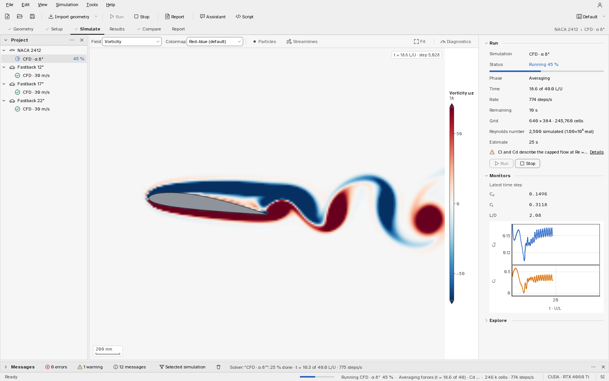
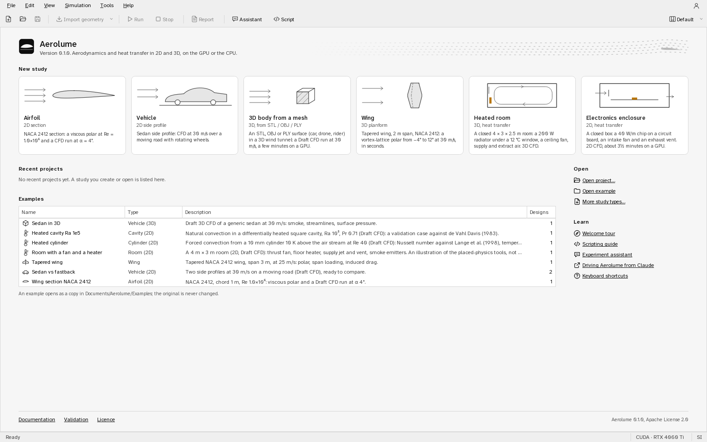
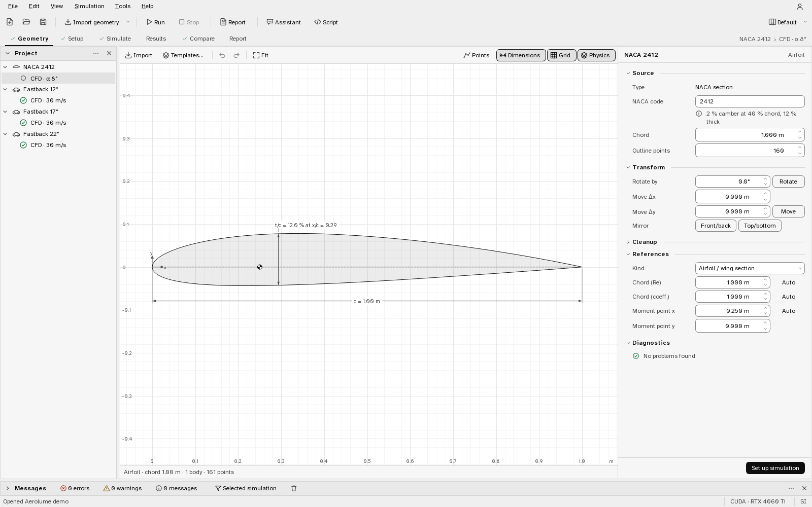
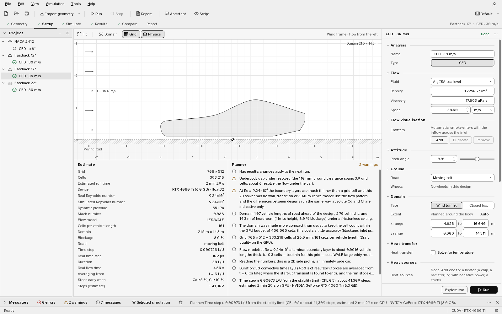
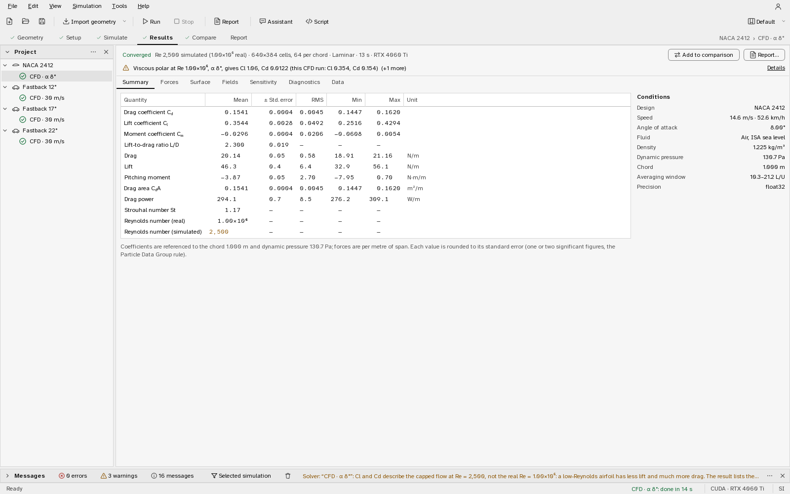
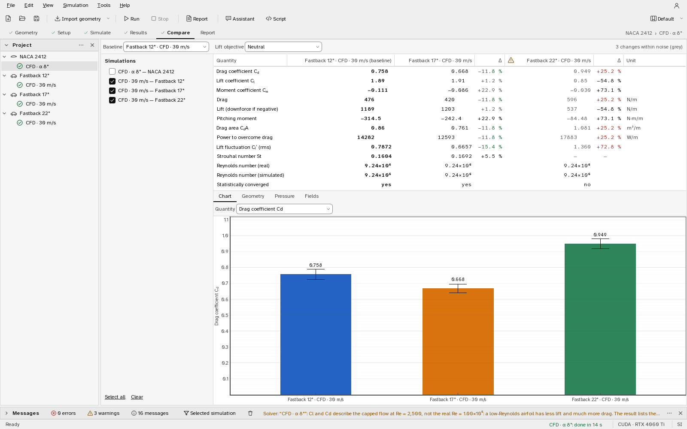
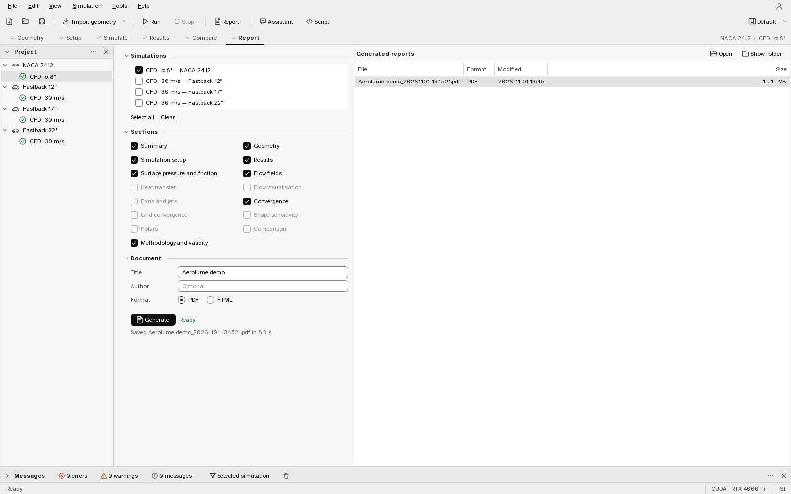

# User guide

This guide follows the application from an empty window to a finished report. It
describes what each page shows and what each control does. How a run is planned, when
it stops and how far to trust its numbers are in the companion chapter
[Running simulations](user_guide_simulation.md); the physics and numerics are in the
theory documents.

Install Aerolume with the Windows installer or from source as described in
[Installing Aerolume](install.md), then start it from the Start menu, or with `aerolume`
(or `python -m aerolume.app`) in a source install. The first start shows a short welcome tour
(Help ▸ Welcome tour shows it again). Sections 1–8 follow the six pages of a study; sections
9–14 cover 3D, the placed physics (heat, smoke, fans and rooms), live editing and the solver
diagnostics, the Script console, the Assistant and the optional accounts.

## 1. The window

| part | what it is for |
|---|---|
| **Menu and toolbar** | New, Open, Save; Import geometry; Run (F5) and Stop (Shift+F5); Report |
| **Step bar** | the six steps of the workflow: Geometry, Setup, Simulate, Results, Compare, Report. The active step is underlined, completed steps carry a check mark. Ctrl+1 … Ctrl+6 jump to them. The right end shows the current design and simulation. |
| **Project** panel (left) | every design with its simulations nested under it. The icon in front of a simulation is its status: not run, queued, running (with the percentage), done, stopped, failed. Selecting an item makes it current on every page. Right-click for New simulation, Run, Duplicate, Rename (F2) and Delete. |
| **Page** (middle) | the current step. Most pages have a viewport in the middle and their settings in the **Properties** panel on the right. |
| **Messages** panel (bottom) | what the planner decided and why, warnings, errors and the run log, with filters for errors, warnings and messages, and for the selected simulation only. It opens by itself when something needs attention. |
| **Assistant**, **Script**, **Flow visualisation**, **Diagnostics** panels | hidden until asked for: the experiment assistant (section 13), the Python console (section 12), the smoke / particle / streamline layers of the flow on screen, and the solver diagnostics of a running simulation (section 11) |
| **Account** button (top right) | optional cloud accounts (section 14); with no account service connected it only says that the program works offline |
| **Status bar** | the last action, the progress of a running simulation, the compute device (for example *CUDA · RTX 4060 Ti*) and the unit system. |

**Panels and workspaces.** Every side panel can be collapsed to its header (the chevron or a
double-click on the header), moved up or down or to another edge (the header's menu),
hidden and brought back from **View** (Alt+1 … Alt+7), and resized by dragging the rail's
edge. Where a panel's effect can be switched off without losing its settings, its header has
an on/off switch (Diagnostics ▸ Record, for example). The arrangement is a *workspace*:
**View ▸ Workspace** offers *Default* (Project and Properties, the log folded at the bottom),
*Analysis* (the Assistant and the open log beside the results), *Live* (Flow visualisation
and Diagnostics beside a live run) and *Scripting* (a tall Script panel, the Assistant on the
right). Each workspace remembers your changes across restarts; **View ▸ Workspace ▸ Reset**
restores the preset. In a narrow window the right-hand panels fold into the left rail as
tabs and return when the window is wider.

Everything is saved as you go: changes to designs and simulations are written to the
project folder when you make them, results when a run finishes. **View** shows or hides
the panels and switches the theme (**View ▸ Theme**, light or dark, also Ctrl+Shift+T);
**Edit ▸ Preferences** (Ctrl+,) sets the theme, the units and the default compute device and
precision. **Tools** has the import, the template gallery and NACA sections, and report
generation.

## 2. Start page and projects

With no project open the window shows the start page: the study types to start from,
**Open project…** and **Open example**, links to this guide, the keyboard shortcuts and the
validation cases, and the projects you used recently and the examples.

* **New airfoil study** creates a project with a NACA 2412 section (chord 1 m) and two
  simulations ready to run: a viscous polar at Re = 10⁶ from −4° to 14°, and a CFD run at
  4° at Draft quality.
* **New vehicle study** creates a sedan side profile on a road with one CFD simulation at
  30 m/s, moving road, Draft quality.
* **3D body from a mesh** imports an STL, OBJ or PLY surface (a car, a drone, a rider) into
  a 3D wind tunnel with a Draft CFD run at 30 m/s (a few minutes on a GPU).
* **Wing (3D)** creates a tapered NACA 2412 wing (2 m span) with a vortex-lattice polar from
  −4° to 12° at 30 m/s, which runs in seconds.
* **Heated room (3D)** creates a closed 4 × 3 × 2.5 m room with a 200 W radiator under a
  12 °C window, a ceiling fan and supply and extract air: 3D CFD with heat transfer and
  buoyancy.
* **Electronics enclosure (2D)** creates a closed box cross-section with a circuit board, a
  40 W/m chip, an intake jet with a fan and a balancing exhaust vent.
* **Empty project** has no geometry: import a 2D outline or a 3D mesh, or start from a
  template.
* **Open example** copies one of the bundled example projects to
  `Documents/Aerolume/Examples` and opens the copy, so the original stays intact. Every
  example contains finished Draft results, so every page has something to show at once:
  *Sedan in 3D* (smoke, streamlines and surface pressure of a 3D car), *Tapered wing* (a
  finite-wing polar), *Heated cylinder* (forced convection at Re 40 against its reference
  Nusselt number), *Heated cavity Ra 1e5* (the natural-convection benchmark),
  *Room with a fan and a heater* (fan, heater, supply jet, vent and two smoke colours in a
  2D room), *Wing section NACA 2412* (a polar and a CFD run at 4°) and *Sedan vs fastback*
  (two car profiles at 30 m/s, ready to compare).

A project is a folder named `<Name>.aerolume` with one JSON file per design and per
simulation and the results next to them (`DESIGN.md` section 5.7 describes the format).
It can be copied, zipped or put under version control as it is.

## 3. Geometry

The viewport draws the design to scale: outline, a light fill, the chord or length
dimension, the maximum thickness of an airfoil, the moment reference point (the circle
with a cross) and, for vehicles, the road. Scroll to zoom, drag to pan, **Fit** to frame
the design; **Points** shows the vertices, **Dimensions** and **Grid** toggle the
annotations.

**Getting a shape in**

* **Templates…** opens the template gallery: NACA 4- and 5-digit airfoils, a two-element
  ground-effect wing, seven road vehicles (sedan, hatchback, fastback, SUV, pickup, van,
  box truck), a 2D Ahmed body, and bluff bodies (cylinder, square, ellipse, flat plate,
  rounded rectangle). A template's parameters (length, height, ground clearance,
  windscreen and rear angles, wheels, …) stay editable afterwards in the inspector.
* **Import** (Ctrl+I, or drop a file on the window) reads airfoil coordinates (`.dat` in
  Selig or Lednicer order), SVG paths, DXF polylines, CSV point lists and silhouettes from
  images (PNG, JPG). The import dialog shows a preview and what it repaired (closed gaps,
  joined open paths, removed duplicate points), asks for the real length of the shape when
  the file has no units, and whether it is an airfoil, a vehicle or a generic body.

**Inspector** (right)

* **Source**: where the shape came from and how many edits it has had.
* **Transform**: chord or length (scales the shape), rotate, move, mirror.
* **Cleanup** (collapsed): resample the outline to a number of evenly spaced points (sharp
  corners are kept) and smooth noisy imported outlines.
* **References**: the kind of design and the reference quantities every coefficient uses:
  the length for the Reynolds number, the length for the coefficients (the chord of an
  airfoil, the frontal height of a vehicle) and the moment point (quarter chord for
  airfoils). *Auto* follows the shape; type a value to fix it.
* **Diagnostics**: problems the solvers would trip over — self-intersections, outlines
  with too few points, trailing edges or gaps too thin for the grid — or *No problems found*.

**Set up simulation** (bottom right) goes to the next step.

## 4. Setup

Setup edits the selected simulation. The top of the page previews the case in the wind
frame (flow from the left, the design rotated by the angle of attack); **Domain** shows the
computational domain the planner chose. Below it, the **Estimate** table and the
**Planner** notes update as you change any setting.

**Property grid**

| group | settings |
|---|---|
| Analysis | name; type: **CFD** (Navier–Stokes, any design) or **Polar** (viscous–inviscid, single airfoils only) |
| Flow | fluid (air at an ISA altitude or a temperature, water, or custom density and viscosity), speed and its unit |
| Attitude | angle of attack (airfoils) or pitch (vehicles), with a slider |
| Ground | road: none, fixed floor or moving belt; whether wheels rotate (vehicles) |
| Mesh & time | quality (Draft, Standard, Fine, or Custom once you override a value), cells per chord / vehicle height, upstream, downstream and height of the domain, duration and the start of averaging; *Auto* everywhere by default |
| Solver (collapsed) | turbulence (auto, laminar, LES), Reynolds number (real or capped) and the cap (fixed when the simulation is made — Re 2,500 for a new capped airfoil, the same on every quality and device; *Auto* lets the grid choose, which changes with the quality), precision, device, sensitivity map and its objective |
| Polar (Polar only) | angle range and step, Ncrit, forced transition on each surface, Mach number, panels |
| Wing analysis (wings only) | method (vortex lattice or lifting line), viscous or inviscid, angle range, sideslip |
| Flow visualisation | smoke and particle emitters (section 10); in 3D without emitters, the automatic smoke rake upstream of the body |
| Domain | **Wind tunnel** (a free stream from the left) or **Closed box** (walls on every side: a room, an enclosure, a cavity) and its extent, Auto or typed |
| Heat transfer | on/off, ambient temperature, buoyancy and gravity, the fluid's thermal properties (Auto from the fluid), each domain wall (adiabatic, temperature or heat flux) and each body's surface condition |
| Heat sources, Fans, Jets and vents | lists of placed items with Add, Duplicate and Remove and the selected item's fields (section 10) |
| Diagnostics (collapsed) | record solver diagnostics (on by default), fixed or PID-controlled time step |

**Estimate** lists what the planner made of these settings: the real and the simulated
Reynolds number, dynamic pressure, flow model, grid and cells, cells per reference length,
domain, blockage, road, time step, duration, averaging start, the early-stop target
("Cd ±5 %, Cl ±10 %"), the number of steps and the estimated run time on the device. The
**Planner** list explains each decision in a sentence and puts warnings first (for
example that lift and drag are not reliable at a Reynolds number the grid cannot resolve,
or that a car's underbody gap is only four cells high). The same lines go to the Messages
panel when the run starts. When the strip under the preview is narrower than about 520 px
(1280 × 800 with the Project and Assistant panels open), the Estimate moves above the Planner,
so neither has to cut its values short; the property grid never gets narrower than its own
fields, and side panels give way first.

New simulations start at **Draft** quality, so the first run comes back in seconds (an
airfoil) to a few minutes (a car). Airfoils above Re = 10⁵ start in the **capped**
Reynolds mode, at Re = 2,500 on every quality and device: the CFD run is a resolved flow at a
lower Reynolds number, and the polar answers at the real one. A simulation added to a design
that has none starts from the fluid, speed, angle, quality and Reynolds settings of the
study's latest CFD run, so the designs of a study are compared at the same conditions. [Running simulations](user_guide_simulation.md) explains both
choices and the presets.

With heat transfer on, the Estimate table adds the temperature scale and the dimensionless
groups the run rests on (Ra, Gr, Pr, Ri, Pe), each with the rule that chose it, and the
planner warns about what the grid or the model cannot carry (an unbalanced closed box, an
item outside the domain, a thermal boundary layer only a few cells thick, a temperature
difference too large for the Boussinesq model).

**Run** (bottom right) queues the simulation and opens Simulate; **Explore live** starts
explore mode (sections 5 and 11).

## 5. Simulate

The viewport shows the running simulation. Its toolbar selects the **field** (speed,
pressure coefficient, vorticity, smoke, eddy viscosity), the **colour map** (each field has a sensible default; no rainbow maps), and
the overlays **Particles** and **Streamlines**; **Fit** frames the design again. The colour
bar on the right edge carries the field's name, unit and ticks; the scale bar at the
bottom left gives the size. Hovering over the field shows the value under the cursor.

The **Run** panel on the right shows the simulation, its status and a progress bar, the
phase (*Transient* while the start-up washes out, then *Averaging*), the simulated time in
convective units, the rate in steps per second, the remaining time, the grid, the
Reynolds number and the estimate. **Stop** ends the run at the next block of steps and
keeps what has been computed as a result marked *Stopped* — except when the run was a
*Run again* of a finished simulation: the partial run is then discarded and the earlier
complete result stays. The panel always describes the simulation selected in the Project
panel: when another one is running, a line above the rows says whose flow the viewport
shows, and for a queued simulation the button reads **Remove from queue**. A polar sweep
shows a busy bar until its first angle is in (the first angle is solved from scratch and
takes most of the start; Setup shows the expected run time). **Monitors** shows the latest
Cd, Cl and L/D and their histories; the averaging window is shaded.

Runs are queued: pressing Run on another simulation while one is running adds it to the
queue (the project tree shows *Queued*). Results are saved to the project as soon as a run
ends.

**Explore** (the collapsed group in the right panel, or *Explore live* on Setup) runs the
flow in real time at Draft resolution (a coarser grid on a CPU), without averaging or an
end — typically 30–50 frames per second on a mid-range GPU — while you drag the angle and
the speed sliders; the field and overlays can change as it runs. Its
grid is shown in the Run panel while it runs. It is for building intuition and finding
interesting cases; its numbers are not results. **Run with these settings** turns the
explored angle and speed (and the moved emitters, fans, heaters and jets) into a simulation
(a new one if the current one already has a result) and queues it. Section 11 describes
drawing obstacles into the running flow, moving placed items, and the diagnostics.

## 6. Results

The header states the facts that decide how far to trust the run: converged or not, the
Reynolds number (simulated and real when they differ), the grid and the cells per
reference length, the flow model, the run time and the device. *Converged* judges the
monitored quantities (the force coefficients, the Nusselt number, each fan's flow); when 5 %
or more of the heat put into the fluid was still being stored at the end, the header says so
("9 % of the heat still being stored"), and above 10 % it is drawn in the warning colour
because the domain had not reached a thermal steady state. A warning line follows when
needed, with **Details** for the full text. **Add to comparison** puts the run on the
Compare page; **Report…** opens the Report page.

| tab | content |
|---|---|
| **Summary** | every coefficient and force with its mean, standard error, RMS, minimum, maximum and unit; the Strouhal number when the flow sheds; the conditions on the right |
| **Forces** | Cd, Cl and Cm against time with the averaging window, and per-body values when there are several bodies |
| **Surface** | pressure and skin-friction coefficients along the surface (upper and lower sides of an airfoil plotted against x/c) |
| **Fields** | the mean and the last instantaneous fields with the same toolbar as Simulate |
| **Heat transfer** | runs with heat transfer: the mean Nusselt number and heat rate of every body with standard errors, the heat balance of the domain, the temperature field and the wall heat flux |
| **Fans** | runs with fans: delivered thrust, volume flow, mean induced speed and ideal power of each fan, beside the momentum-theory reference |
| **Diagnostics** | the solver's end-of-run divergence, change norms, CFL number, time step and residual (section 11) |
| **Sensitivity** | the shape-sensitivity map on the outline, when it was computed (Setup ▸ Solver ▸ Sensitivity map), relative to its strongest values: the pattern is reliable, the size only indicative (the values in 1/m are in the surface CSV) |
| **Polar** | polar simulations only: Cl(α), drag polar, Cm(α), L/D and transition, and the table of points. (A CFD run of a single airfoil states its polar cross-check in the header warning and the Messages panel.) |
| **Data** | the raw numbers and the exports: summary, force history, surface data and polar table as CSV, flow fields as VTK (`.vti`, for ParaView) or NumPy `.npz`, and every figure as PNG |

Every value is rounded to its standard error. A run that ended before its uncertainty
target is labelled *Not converged* and its error bars say how far it got; when the run was
too short to measure its error bars (fewer than about 20 independent samples), its warning
says they are rough estimates, the report marks them with ~, and Compare does not call a
difference significant on them. A polar whose lift is still rising at its last angle shows
Cl,max as a lower bound ("≥ 1.547, still rising at α = 14°"): extend the last
angle in Setup to find the stall.

## 7. Compare

Compare puts simulations with results side by side. Tick them in the list on the left
(at most what fits the table; four by default, preferring runs of the same kind — CFD with
CFD, polars with polars), choose the **Baseline**, and tell the page whether more lift is
good (a wing), bad (a race car's front wing producing downforce reads negative lift) or
neither (a road car) with **Lift objective**.

The table lists every quantity for every simulation and, for each variant, the change
against the baseline in per cent. Green and red mark improvements and deteriorations;
**grey marks a change smaller than the combined statistical uncertainty of the two runs** —
not a real difference. A warning icon in a column header flags a run that did not
converge. Below the table:

* **Chart**: a bar chart of the chosen quantity with error bars.
* **Geometry**: the outlines overlaid in their series colours.
* **Pressure**: surface pressure of all selected runs.
* **Polars**: the polars of the selected polar simulations.
* **Fields**: one field of each run on the same scale, or the difference to the baseline.

Compare designs run at the same quality and conditions: a Draft and a Standard run of the
same car differ by more than most design changes. A warning line above the table says when
the compared runs differ in speed, angle or fluid, or simulate different Reynolds numbers,
because their differences are then not design effects alone (the report prints the same
warnings). With runs of both kinds selected, the baseline is a CFD run: a polar has no single
Cd to compare against.

## 8. Report

Choose the simulations (all with results are ticked), the sections — summary, geometry,
setup, results, surface pressure and friction, flow fields, convergence, shape
sensitivity, airfoil polars, comparison, methodology and validity — a title, an author and
the format (PDF or HTML), then **Generate**. Reports are written to the project's
`reports` folder on a background thread and listed on the right with their size; **Open**
and **Show folder** act on the selected one. Every report states the conditions, the
uncertainty and the validity limits of each number it contains (the methodology section
says how they were obtained).

## 9. Three dimensions and finite wings

A 3D design is a surface mesh (**File ▸ Import ▸ 3D mesh (STL, OBJ, PLY)…**, Ctrl+Shift+I, or
a primitive) or a wing (**Tools ▸ New wing**). The Geometry page shows it in a 3D view (orbit
with the left mouse button, pan with the middle one, scroll to zoom; Iso, Front, Side and Top
views) with a mesh inspector: parts, units, size, watertightness and the checks the solver
needs. A vehicle sits on the road (z = 0); a body that is symmetric about the centre plane is
solved on a half domain with a symmetry plane, which halves the cost.

A 3D CFD run shows its flow in the 3D view of Simulate and Results: surface pressure,
**smoke** (volume rendering of the released dye, up to four colours), **streamlines** from a
rake you can move, vortex iso-surfaces and slices through the mean flow. The Flow
visualisation panel switches the layers. A wing runs the finite-wing analysis instead (a
vortex lattice or a lifting line on the section polars, seconds): lift, induced and profile
drag, span loading and the stall-onset estimate. How a 3D run is planned and how far its
numbers go are in [Running simulations](user_guide_simulation.md), sections 10–12.

## 10. Heat, smoke, fans and rooms

The groups below **Mesh & time** on Setup place physics into a simulation. It works in 2D
and 3D with the same meaning, and everything is off until you add it.

* **Emitters** (Flow visualisation): a point, a line or a rake of nozzles, a rectangle, or
  in 3D a disc or a plane, releasing smoke (a passive dye) or tracer particles (streaklines;
  pulsed emitters draw timelines). Each colour is its own smoke channel, up to four.
  *Wind* emitters stay put when the body is pitched or yawed; *body* emitters move with it.
* **Heat transfer**: the temperature is solved with the flow, with buoyancy on or off. A
  body is held at a temperature, releases a heat flux or is adiabatic; each domain wall
  likewise. Results gain the temperature field, the heat rate of every body (W, or W per
  metre of span in 2D) and its mean Nusselt number with a standard error.
* **Heat sources**: a heater (or a cooler, with negative power) of a given power over a
  rectangle or box, a disc or a sphere.
* **Fans**: an actuator disc (a strip in 2D) blowing along its direction, set by its thrust,
  its pressure jump, or a target speed through it that the solver regulates. The result
  reports the delivered thrust, volume flow, mean induced speed and ideal power.
* **Jets and vents**: fluid blown in at a speed (optionally hotter or colder, optionally
  carrying smoke) or sucked out. In a closed box the jets and vents must balance; the planner
  says when they do not.
* **Domain ▸ Closed box** turns the wind tunnel into a room with walls on every side. A room
  without a free stream takes its speed scale from its fastest jet or fan, or from buoyancy.
  A closed box is judged on what it is about (the Nusselt number, the warmest and the mean
  fluid temperature, fan flow, kinetic energy), never on force coefficients. In **2D** a room's
  fan speeds, disc velocity and volume flow are qualitative and depend on the grid (2D flow has
  no vortex stretching; theory_ns2d.md section 18.4): the thrust is exact and the flow pattern
  meaningful, but use 3D for numbers.

**Planned and measured temperatures.** A heater's or a heat flux's temperature rise is not
known before the run, so the planner estimates it (from the air flowing through the heater)
and sizes the run on that estimate. After the run, Results and the report label the plan's
ΔT, Rayleigh and Grashof numbers *(planned estimate)* and give the measured ones beside them,
and the Setup page re-states its warnings on the measured rise while the settings are those of
the stored result. A ΔT set by the walls and bodies (the cavity's hot and cold walls) is exact
and has no label. Natural or mixed convection around a heated body (a free plume) is not
validated, and a run in that regime says so in its warnings.

The Setup preview draws every item with handles; drag them, or type positions in the list.
Results add the heat summary (Nusselt number, heat rate, the energy balance), a fan table, the
run's diagnostics and, for a reference case (the heated cylinder, the cavity), the comparison
with the published value. The examples *Heated cylinder*, *Heated cavity Ra 1e5* and *Room
with a fan and a heater* show each of these with finished results. What the planner chooses,
the measured accuracy and the limits are in [Running simulations, section
13](user_guide_simulation.md); the validation against de Vahl Davis, Lange et al., momentum
theory and the jet similarity laws is in the [validation report](validation.md).

## 11. Explore: drawing into the flow, diagnostics and the solver trace

**Explore** (**Start explore** on Simulate, or **Simulation ▸ Explore live**) runs the flow
continuously at Draft resolution. While it runs:

* The **drawing strip** above the 2D view has a **brush** and a **polygon** tool that add
  solid obstacles to the running flow, an **eraser**, **undo / redo / clear**, the brush
  size, and a **move** tool that drags emitters, fans, heaters and jets to a new place. The
  flow keeps running; the drawing is resolution-independent and never changes the design.
  In 3D, obstacles are placed as spheres and boxes.
* The sliders change the angle and the speed; with the **Reynolds lock** two of speed,
  viscosity and Reynolds number are held and the third follows. **Pause**, **Step**, the
  target frame rate and the steps per frame control the pace.
* Edits the session cannot carry out are said in Messages, not silently ignored: a speed
  change in a closed box (it has no free stream), an item moved out of the domain, or heat
  added to a session started without heat transfer (restart explore to add it).

The **Diagnostics** panel (Alt+7; open in the *Live* workspace) shows whether the solver is
doing its job: the RMS divergence after the projection, the change of each field per step
block (absolute and relative), the CFL number and time step, the pressure-solve residual and
the throughput, as numbers and as plots against step or time. Its header switch pauses
recording and keeps the values; **Export CSV** writes every column at full precision. A
converged-looking picture with a divergence of 10⁻² is a broken run; change norms that stopped
falling mean a steady state or a limit cycle.

The panel's **Solver trace** tab records one time step stage by stage (**Capture step**): the
tentative velocity after advection and diffusion, its divergence, the pressure correction and
the corrected velocity, one row per Runge–Kutta stage. Each stage is a thumbnail; one is
enlarged with its colour bar; colour ranges are shared per quantity or separate; **Export
NPZ…** saves every array. Production runs record diagnostics too (Setup ▸ Diagnostics):
the Results page's Diagnostics tab keeps their end-of-run values with the result, and the
step-by-step history for the session that ran it.

## 12. The Script console and the scripting API

**Tools ▸ Run script…** or the **Script** panel (Alt+4) runs Python against the open project
with `al` (the `aerolume` package) and `project` bound: add designs, run simulations through
the same queue as the Run button, sweep parameters, plot and export. Output and figures
appear inline; **Stop** cancels a run (keeping its partial result) or interrupts plain Python;
an error marks its line. Scripts are saved with the project, and the examples menu has short
starting points. The same API works outside the program (`import aerolume as al`) and from
the command line (`aerolume-cli script study.py --project "Wing study.aerolume"`): see the
[scripting guide](scripting.md).

## 13. The experiment Assistant

The **Assistant** panel (Alt+3, or **Tools ▸ Experiment assistant**, Ctrl+Shift+A) plans, runs
and analyses experiments from a goal written in plain words, through the scripting API. It
works with Claude (an Anthropic API key in **Edit ▸ Preferences ▸ Assistant**) or with a local
model through Ollama, in which case nothing leaves the computer. Its rules:

* nothing is sent to a model off this computer until you agree on a card that lists what is
  sent and what is not (meshes, flow fields, figures and the project's files are not);
* a suggested change arrives as a card listing every setting old → new and changes nothing
  until you click **Apply** (one Undo takes it back); runs above the approval threshold,
  code and deletions ask first;
* every statement in a final answer is checked against the project's numbers and marked
  verified or *not verified*.

Claude Desktop or Claude Code can drive the same tools without an API key in the program
through the `aerolume-mcp` server (**Help ▸ Driving Aerolume from Claude (MCP)**). Details:
[the Assistant](ai_assistant.md) and [the MCP server](mcp.md).

## 14. Accounts (optional)

Aerolume works fully offline and needs no account; nothing is sent anywhere by default. An
account service exists only once you connect a Supabase project of your own (**Edit ▸
Preferences ▸ Account**: the project URL and its public anon key). Then the Account button
offers sign-up and sign-in (email and password, a magic link or a 6-digit code, or GitHub /
Google through the system browser), a profile, **Cloud projects** (upload, download, sync
status, conflicts detected by content hash) and expiring read-only **share links** for a
result. Sessions are stored in your user folder with restrictive permissions and never
logged. Setting up a project, what leaves your computer and the security model are in
[Accounts](accounts.md).

## 15. Keyboard shortcuts

| keys | action |
|---|---|
| Ctrl+N / Ctrl+O / Ctrl+S | new study / open project / save |
| Ctrl+I | import geometry |
| Ctrl+1 … Ctrl+6 | Geometry … Report |
| F5 / Shift+F5 | run the selected simulation / stop the running one |
| F2 / Delete | rename / delete the selected design or simulation |
| Ctrl+, | preferences |
| Ctrl+Shift+T | switch between the light and the dark theme |
| Alt+1 … Alt+7 | show or hide the Project, Messages, Assistant, Script, Properties, Flow visualisation and Diagnostics panels |
| F11 | full screen |
| F6 / Shift+F6 | next / previous region: the step bar, the page, then each panel's header |
| Enter, Shift+F10, Delete | on a panel header: collapse or expand, the options menu, hide the panel |
| Ctrl+Tab / Ctrl+Shift+Tab | leave the Script editor (Tab indents there); Esc then Tab also works |
| F1 | this guide |

**Moving around with the keyboard.** Tab goes from the step bar into the page, through the
page's fields in reading order, and then into the panels (left rail, right rail, bottom), and
wraps round; Shift+Tab walks the same order backwards. The panel headers' own buttons are not
Tab stops: F6 lands on a header, where Enter or Space collapses or expands the panel, Shift+F10
or the Menu key opens its options and Delete hides it, and Tab goes into its content. F6 back to
the page returns to the field you left. Every control is at least 24 pixels high. In the Script
editor Tab indents the code; Ctrl+Tab (or Esc followed by Tab) moves on, and **More ▸ Tab key
moves focus** makes Tab leave the editor instead.

## 16. When something goes wrong

* **A run fails.** The project tree shows *Failed*, the Messages panel the reason in one
  sentence (out of GPU memory, an unstable flow, a geometry problem) and what to do. The
  table in [Running simulations, section 9](user_guide_simulation.md#9-when-something-goes-wrong)
  lists the messages.
* **A run is much slower than its estimate.** Another program is using the GPU (games,
  video encoders, other simulations). The estimate adapts after each run.
* **No GPU is found.** Run `aerolume-cli doctor`: it lists the devices PyTorch sees and runs
  a one-second solver check. Everything works on the CPU, with coarser grids and longer
  run times; the planner says so.
* **A page shows an error instead of its content.** It names the failing module and offers
  *Retry*. Please report it with the text shown.
