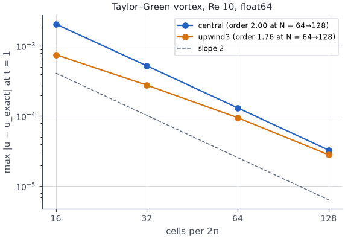
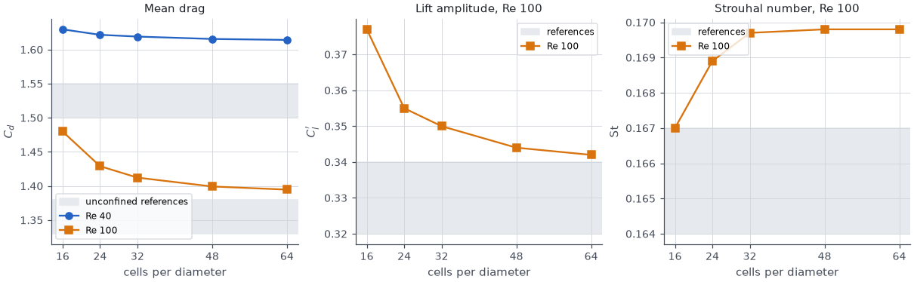
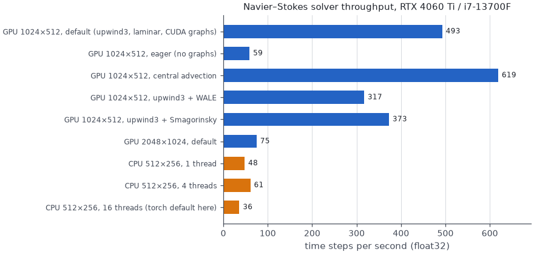
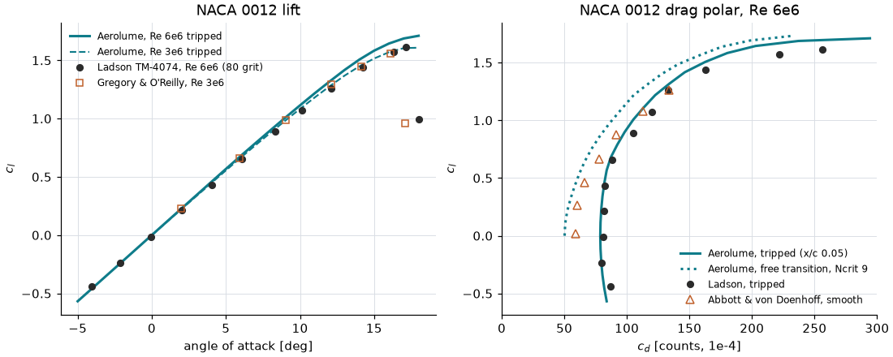
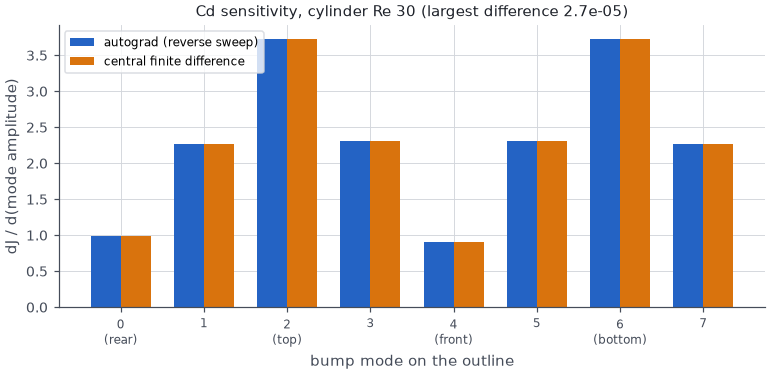
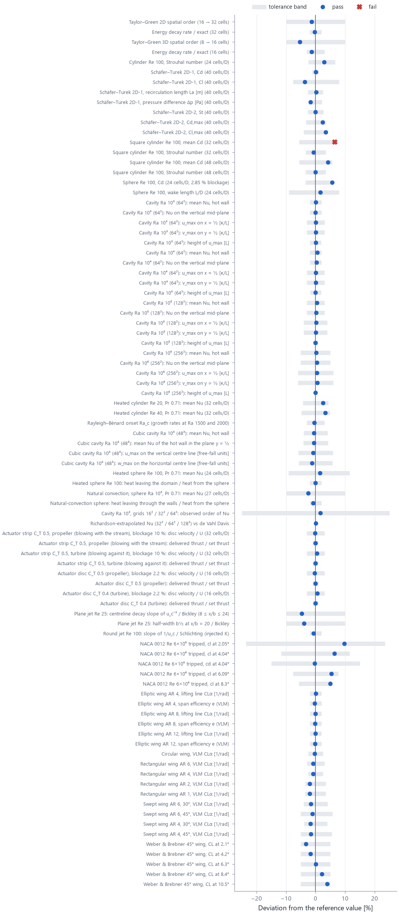
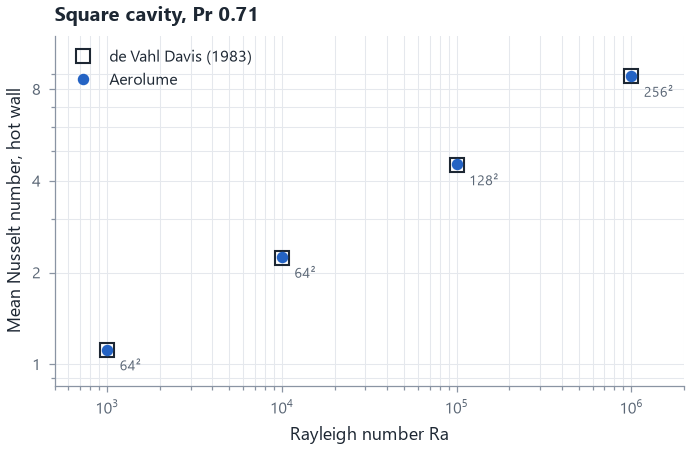
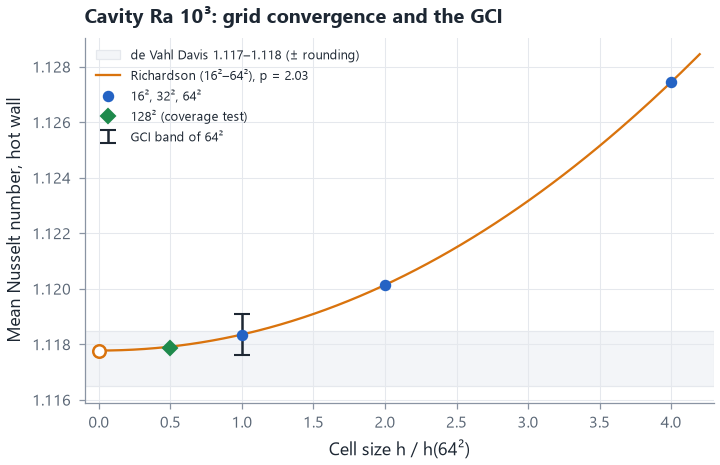

# Validation report

This report collects the evidence that Aerolume's numbers are right, and says where they
stop being right. It covers the Navier–Stokes solver (verification against exact answers,
validation against published benchmarks, performance), the airfoil polar solver (against
wind-tunnel data and XFOIL) and the shape-sensitivity maps (against finite differences), in
2D (sections 1–7) and in 3D (section 8: the 3D solver, finite wings, 3D sensitivity maps).
Section 9 is the automated run of every case, including heat transfer (natural and forced
convection in 2D and 3D), fans and jets, smoke emitters and the grid-convergence uncertainty
estimate itself; it is written by `validation/run_all.py` from the run it describes.
Section 10 lists what is not validated. The detailed derivations and every intermediate table
are in the theory documents ([Navier–Stokes solver](theory_ns2d.md), [airfoil
validation](validation_airfoil.md), [sensitivity maps](theory_sensitivity.md)); the methods are
summarised, with references, in [methods](methods.md); this page is the summary with figures.

Everything here was measured on the development machine: an NVIDIA RTX 4060 Ti (8 GB)
and an Intel i7-13700F under Windows 11, PyTorch 2.14 with CUDA 13.0, float32 on the GPU
unless stated. The GPU was shared with other programs during several of the runs, so wall
times are upper bounds. The scripts that produce the numbers are in `validation/`:

```
python validation/run_all.py --all --write-docs    # every case, compared with its reference (section 9)
python validation/run_all.py --quick               # the same checks on coarse grids, a few minutes
python validation/bench_ns2d.py verify             # exact-answer checks
python validation/bench_ns2d.py cylinder           # cylinder grid study (Re 40, 100)
python validation/bench_ns2d.py channel            # Schäfer–Turek 2D-1, 2D-2
python validation/bench_ns2d.py square             # square cylinder, Re 100
python validation/bench_ns2d.py perf               # throughput
python validation/airfoil_validation.py            # polars against wind-tunnel data and XFOIL
python validation/make_validation_figures.py       # the figures on this page
```

and the same checks, with tolerances, run in the test suite (`pytest -m slow` for the
GPU validation cases; `aerolume-cli validate` runs a quick subset on any machine). How to run
and extend the validation: [validation/README.md](../validation/README.md).

## Summary

| area | check | result |
|---|---|---|
| Pressure projection | discrete Poisson residual, float64 | 4.1 × 10⁻¹⁴ (round-off) |
| Incompressibility | max \|∇·u\| h/U, float32 on the GPU | 1.8 × 10⁻⁷ (bar: 10⁻⁵) |
| Spatial accuracy | Taylor–Green vortex, central advection | order 1.97 → 1.99 → 2.00 |
| Bluff body, steady | cylinder Re 40, 32 cells/D: C<sub>d</sub>, L/D, separation | 1.619, 2.28, 53.5° from the rear |
| Bluff body, shedding | cylinder Re 100, 32 cells/D: C<sub>d</sub>, C<sub>l</sub>′, St | 1.412, 0.350, 0.170 |
| Confined flow | Schäfer–Turek 2D-1, 80 cells/D: C<sub>d</sub>, C<sub>l</sub>, L<sub>a</sub>, Δp | 5.578, 0.0105, 0.0846 m: in the benchmark bands; Δp −0.5 % |
| Confined, periodic | Schäfer–Turek 2D-2, 80 cells/D: St, C<sub>l,max</sub>, C<sub>d,max</sub> | 0.301, 1.004: in the bands; C<sub>d,max</sub> +0.5 % |
| Sharp edges | square cylinder Re 100, 32 and 48 cells/D: C<sub>d</sub>, St | 1.582 (+5.9 %, **fails** its ± 5 % band) and 1.549 (+3.7 %); St 0.146 and 0.147 (in range) |
| Airfoil polar | NACA 0012, tripped, Re 6 × 10⁶, vs Ladson | c<sub>d</sub> within 6 %, c<sub>l</sub> within 0.05 to 8° |
| Airfoil polar | vs XFOIL 6.99, identical geometry, 6 polars | c<sub>l</sub> within 0.012, c<sub>m</sub> 0.0026, c<sub>d</sub> 2.4 % |
| Sensitivity map | autograd vs central finite differences, cylinder Re 30 | relative error 4 × 10⁻⁶ to 2.7 × 10⁻⁵ |
| Performance | GPU, 1024 × 512, float32 | 493 steps/s (target 300) |
| Natural convection | square cavity Ra 10³–10⁶ (64²–256²): hot-wall mean Nu vs de Vahl Davis | 1.1184, 2.2507, 4.5314, 8.8405 against 1.117, 2.238, 4.509, 8.817 (+0.1 to +0.6 %); hot and cold walls agree to 4 × 10⁻⁷ |
| Natural convection, 3D | cubic cavity Ra 10⁴, 48³: hot-wall mean Nu; symmetry plane Nu, u_max, w_max | 2.066 (published 2.054–2.100); 2.263, 0.1981, 0.2210 (published 2.25–2.302, 0.198–0.2013, 0.222–0.2252) |
| Convection onset | Rayleigh–Bénard, rigid isothermal plates | Ra_c 1701 (exact 1707.76, −0.4 %) |
| Forced convection | heated cylinder Re 20 and 40 (32 cells/D), heated sphere Re 100 (24 cells/D) | Nu 2.503 and 3.336 (published 2.433–2.448 and 3.200–3.255; +2.2 % and +2.5 % above the ranges with 5 % blockage), 7.03 (correlations 6.62–7.35) |
| Natural convection, 3D body | heated sphere in a closed box, Ra 10⁴, Pr 0.71, grids of 12, 18 and 27 cells/D | Nu 6.385 at 27 cells/D against 6.545 from Churchill's (1983) correlation (−2.4 %); monotone grid study, observed order 1.61, GCI 2.9 %; heat balance 0.9915 |
| Fans | actuator strip (2D, C_T 0.5) and disc (3D, C_T 0.5 and 0.4), each blowing with and against the stream, vs confined momentum theory | disc velocity −0.15 % and +0.45 % (2D), −0.34 % and +0.67 % (3D); set thrust delivered to 3 × 10⁻⁸ |
| Discretisation uncertainty | GCI of the Ra 10³ cavity (16²–64²), tested on 128² | observed order 2.03; the 128² value lies at 0.69 of the 64² GCI half-width |
| Jets | plane jet from a port, Re 25, closed box; round jet, Re 100 | plane: centreline decay −4.7 % and half-width −3.9 % against Bickley, core momentum budget closes to 0.27 % of K; the momentum-flux drift check **fails**: 6.2 % over 8 ≤ x/b ≤ 24 (band 5 %; section 10). Round: decay slope −0.7 % against Schlichting, budget 0.12 % |

The heat-transfer, fan, jet, emitter and uncertainty rows come from the automated run of
section 9, where every check is listed with its band and source. The numbers are deterministic
on this machine: the previous full run (30 October 2026, a development build before 0.1.0; since
then the 2D solver gained a time-step bound for heat sources and the suite the natural-convection
sphere) printed the same value, to the four significant figures shown, for every check the two
runs share.

## 1. Verification: exact answers

| check | result | bar |
|---|---|---|
| Poisson solve `‖Lψ − f‖/‖f‖`, float64 | 4.1 × 10⁻¹⁴ | round-off |
| projected divergence `max|∇·u| h/U`, float64 | 3.9 × 10⁻¹⁶ | < 10⁻¹⁰ |
| projected divergence, float32 (GPU) | 1.8 × 10⁻⁷ | < 10⁻⁵ |
| Taylor–Green, central, observed order | 1.97, 1.99, 2.00 | ≈ 2 |
| Taylor–Green energy decay rate / exact (N = 64) | 0.9992 | 1 |
| outlet mass balance after 30 steps | < 10⁻¹⁰ | exact |
| CUDA graph against eager execution, 34 steps, float32 | agree to 10⁻⁶ | same kernels |
| shape gradient d(mean C<sub>d</sub>)/d(shape), autograd vs central FD, float64 | 5.030 vs 5.030, relative error 2.3 × 10⁻⁷ | < 5 % |



The pressure projection is exact (a direct DCT/FFT solve of the discrete Poisson
equation), so every stage of every time step is divergence-free to round-off. Central
advection converges at second order. Third-order upwind advection has a smaller error at
every resolution tested, and its observed order rises towards 2 as its third-order
dissipation term dies out (theory document, section 3).

## 2. Circular cylinder, Re 40 and Re 100

Wide domain [−10, 20] × [−10, 10] diameters (5 % blockage, slip walls), uniform inflow,
upwind3 advection, float32 on the GPU. Re 40 is averaged over t = 50–60 D/U, Re 100 over
t = 100–200 D/U.



| case | cells/D | grid | C<sub>d</sub> | C<sub>l</sub>′ | St | L/D | wall time |
|---|---:|---|---:|---:|---:|---:|---:|
| Re 40 | 16 | 480 × 320 | 1.630 | — | — | 2.320 | 3 s |
| Re 40 | 32 | 960 × 640 | 1.619 | — | — | 2.280 | 16 s |
| Re 40 | 64 | 1920 × 1280 | 1.614 | — | — | 2.256 | 399 s |
| Re 100 | 16 | 480 × 320 | 1.480 | 0.377 | 0.1670 | — | 30 s |
| Re 100 | 32 | 960 × 640 | 1.412 | 0.350 | 0.1697 | — | 59 s |
| Re 100 | 64 | 1920 × 1280 | 1.395 | 0.342 | 0.1698 | — | 876 s |

References (unconfined): Re 40 C<sub>d</sub> 1.50–1.55, recirculation length L/D 2.13–2.35;
Re 100 C<sub>d</sub> 1.33–1.38, C<sub>l</sub>′ 0.32–0.34, St 0.164–0.167 (Dennis & Chang
1970, Fornberg 1980, Coutanceau & Bouard 1977, Williamson 1989, Liu et al. 1998, Linnick &
Fasel 2005, Taira & Colonius 2007).

* **Grid convergence** is monotone: from 32 to 64 cells per diameter C<sub>d</sub> changes by
  0.3 % (Re 40) and 1.2 % (Re 100), St by 0.1 %.
* **Accuracy.** Drag is about 5 % above the unconfined references and St about 2 %. That is
  the blockage of the 5 % domain: the 2D wake-blockage estimate ε ≈ (C<sub>d</sub>/4)(D/H)
  raises the effective dynamic pressure by about 4 %, and the measured slip-wall velocity
  abeam the cylinder is 1.04 U (Re 40) and 1.02 U (Re 100). The separation angle at Re 40 is
  53.5–54.0° from the rear (Dennis & Chang 1970: 53.8°), and the surface-integrated drag
  agrees with the solver's momentum balance to 0.1 % (Re 40) and 0.7–2.1 % (Re 100).
* At 16 cells per diameter (below the Draft preset for bluff bodies) drag is 6 % and the lift
  amplitude 10 % above the converged values; St is within 2 %.

## 3. Channel and sharp-edged benchmarks

**Schäfer–Turek 2D-1 and 2D-2** (Schäfer & Turek 1996): a cylinder of diameter D = 0.1 m in
a 2.2 m × 0.41 m channel with no-slip walls, centred 0.2 m from the inlet and 0.2 m above the
lower wall (slightly off the centre line), parabolic inflow. Re = Ū D/ν = 20 (steady, 2D-1)
and 100 (periodic, 2D-2), with Ū the mean inflow velocity, which is also the reference speed of
the coefficients. The pressure difference Δp is between the front and rear points of the
cylinder, in the benchmark's units (ρ = 1 kg/m³, Ū = 0.2 m/s); L<sub>a</sub> is the
recirculation length behind the cylinder in metres. The benchmark's own grids resolve the
cylinder with body-fitted meshes; here the cylinder is an immersed body on a uniform grid.

**Square cylinder, Re 100**: side D, faces normal to the flow, in the same 5 % domain as the
circular cylinder. Published values for about 5 % blockage: C<sub>d</sub> 1.477 and St
0.146 (Sohankar, Norberg & Davidson 1998), 1.488 and 0.145 (Darekar & Sherwin 2001), 1.494
and 0.149 (Sharma & Eswaran 2004).

| benchmark | quantity | reference | cells/D | grid | Aerolume | difference | wall time |
|---|---|---|---:|---|---:|---:|---:|
| 2D-1, Re 20 | Cd | 5.57–5.59 | 40 | 880 × 164 | 5.5848 | in range | 15 s |
| 2D-1, Re 20 | Cd | 5.57–5.59 | 80 | 1760 × 328 | 5.5781 | in range | 156 s |
| 2D-1, Re 20 | Cl | 0.0104–0.0110 | 40 | 880 × 164 | 0.01032 | −0.8 % | 15 s |
| 2D-1, Re 20 | Cl | 0.0104–0.0110 | 80 | 1760 × 328 | 0.01052 | in range | 156 s |
| 2D-1, Re 20 | La | 0.0842–0.0852 | 40 | 880 × 164 | 0.08491 | in range | 15 s |
| 2D-1, Re 20 | La | 0.0842–0.0852 | 80 | 1760 × 328 | 0.08460 | in range | 156 s |
| 2D-1, Re 20 | Δp | 0.1172–0.1176 | 40 | 880 × 164 | 0.11543 | −1.5 % | 15 s |
| 2D-1, Re 20 | Δp | 0.1172–0.1176 | 80 | 1760 × 328 | 0.11664 | −0.5 % | 156 s |
| 2D-2, Re 100 | Cd,max | 3.22–3.24 | 40 | 880 × 164 | 3.3064 | +2.0 % | 18 s |
| 2D-2, Re 100 | Cd,max | 3.22–3.24 | 80 | 1760 × 328 | 3.2556 | +0.5 % | 99 s |
| 2D-2, Re 100 | Cl,max | 0.99–1.01 | 40 | 880 × 164 | 1.0341 | +2.4 % | 18 s |
| 2D-2, Re 100 | Cl,max | 0.99–1.01 | 80 | 1760 × 328 | 1.0044 | in range | 99 s |
| 2D-2, Re 100 | St | 0.295–0.305 | 40 | 880 × 164 | 0.2999 | in range | 18 s |
| 2D-2, Re 100 | St | 0.295–0.305 | 80 | 1760 × 328 | 0.3013 | in range | 99 s |
| Square cylinder, Re 100 | Cd | 1.477–1.494 | 32 | 960 × 640 | 1.5818 | +5.9 % | 81 s |
| Square cylinder, Re 100 | Cd | 1.477–1.494 | 48 | 1440 × 960 | 1.5489 | +3.7 % | 362 s |
| Square cylinder, Re 100 | St | 0.145–0.149 | 32 | 960 × 640 | 0.1461 | in range | 81 s |
| Square cylinder, Re 100 | St | 0.145–0.149 | 48 | 1440 × 960 | 0.1470 | in range | 362 s |

* **Schäfer–Turek 2D-1.** At 80 cells per diameter C<sub>d</sub>, C<sub>l</sub> and the
  recirculation length are inside the benchmark bands and the pressure difference is 0.5 %
  below its band; at 40 cells per diameter C<sub>d</sub> and L<sub>a</sub> are already
  inside, C<sub>l</sub> 0.8 % and Δp 1.5 % low. The small lift (C<sub>l</sub> ≈ 0.01 from the
  0.05 D offset of the cylinder) is a sensitive test of the wall placement and is reproduced.
* **Schäfer–Turek 2D-2.** The Strouhal number is inside its band at both resolutions; the
  peak drag is 2.0 % (40 cells/D) and 0.5 % (80 cells/D) above the band, the peak lift 2.4 %
  above at 40 and inside at 80. The run averages t = 40–60 D/Ū after a perturbed start.
* **Square cylinder.** The Strouhal number is inside the published range at both
  resolutions. The drag is high: +5.9 % above the published range at 32 cells per diameter
  and +3.7 % at 48, converging towards it from above (−2.1 % between the two grids). This is
  the largest deviation in the CFD validation set. Sharp corners are where a one-cell diffuse
  interface converges most slowly: the separation point is fixed at the corner, but the
  shear layer leaving it is smeared over the interface width. Bluff bodies with sharp edges
  (the square, the trucks' box fronts, sharp-edged car tails) therefore read a few per cent
  high in drag at Draft and Standard resolution. Compare such designs at the same quality, so
  that they share the offset.
* **The square cylinder's band in section 9, and how it changed.** In early development the automated run
  checked the 32 cells/D drag against the published range +8 % above (1.477 … 1.614). That
  band was written after the +5.9 % above was known from this section, so it contained a known
  result and tested nothing, while the section 9 header said bands were set before the runs.
  Before the first release the drag moved to the rule of the other 2D bands: the published range widened by a
  stated resolution allowance, ± 5 % (1.403 … 1.569), the widest allowance those bands already
  used (Schäfer–Turek 2D-1 lift at 40 cells/D). The run now measures 32 and 48 cells/D: the
  32 cells/D drag fails that band and stays in the table as a failure, and 48 cells/D is the
  grid that passes. The rule was not tuned to this case, but it was chosen with the 48 cells/D
  value (+3.7 %) already known, so read the 48 cells/D pass as consistent with the earlier
  study rather than as a blind test.

## 4. Vehicles and high Reynolds numbers

There is no reference solution for a 2D car at Re 10⁷, so the checks here are robustness
and consistency, not accuracy:

* **Moving ground with rolling wheels, Re 10⁶, WALE LES** (`bench_ns2d.py ground`, slow test
  `test_moving_ground_les_re1e6_stable`): 1024 × 307 cells, 19 000 steps, no instability,
  divergence at float32 round-off, eddy viscosity active only at the grid scale.
* **Sedan template, Draft, 30 m/s, moving road** (720 × 450 cells, 7.7 % blockage): mean
  C<sub>d</sub> 0.63 ± 0.05 and C<sub>l</sub> 2.5 ± 0.3 per frontal height in 92–125 s on the
  shared GPU; repeated on the same machine it reproduced to the last digit. Development runs
  with other run lengths and planner versions gave C<sub>d</sub> 0.57–0.63. At Standard
  quality (972 × 1080)
  C<sub>d</sub> is 0.72 ± 0.02 and C<sub>l</sub> 2.2 ± 0.1. The Draft-to-Standard change
  (+20 % drag, −25 % lift) is larger than many design changes, which is why the program
  tells users to compare designs at the same quality.
* These coefficients are those of an infinitely wide side profile and are far above
  wind-tunnel values for a real car (about 0.3 and 0.1–0.4); see
  [Running simulations, section 6](user_guide_simulation.md#6-reading-results-honestly).

## 5. Performance



| device | grid | options | steps/s | target |
|---|---|---|---:|---:|
| RTX 4060 Ti | 1024 × 512 | default (upwind3, laminar, CUDA graphs) | 493 | ≥ 300 |
| RTX 4060 Ti | 1024 × 512 | eager execution, no CUDA graphs | 59 | |
| RTX 4060 Ti | 1024 × 512 | upwind3 + WALE LES | 317 | |
| RTX 4060 Ti | 2048 × 1024 | default | 75 | |
| i7-13700F | 512 × 256 | 4 threads | 61 | ≥ 15 |

CUDA graphs give the GPU an eight-fold speed-up: a time step launches a few hundred small
kernels, and under the Windows display driver each launch costs about 27 µs. In the
application, the Draft airfoil runs (245 760 cells) take about 7–20 s including set-up, output
and the live view (6.5–13 s without the live view, October 2026); the Draft sedan (324 000 cells, about 30 000 steps) 1.5–2 minutes (3 minutes
when another program loads the GPU).
A 19-angle polar of NACA 2412 at Re 10⁶ takes about 30 s on one CPU core in the application,
about 9 s of it for the first, cold-started angle.

## 6. Airfoil polar solver

The polar solver is validated against wind-tunnel data for NACA 0012, 2412 and 4412 at
Re 3–6 × 10⁶ and against XFOIL 6.99 on identical coordinates; the full tables and figures
are in [Airfoil polar solver: validation](validation_airfoil.md).



| check | target | result |
|---|---|---|
| c<sub>l</sub>, NACA 0012, 0–8°, vs Ladson / Gregory / Abbott & von Doenhoff | within 0.05 | max 0.044 / 0.012 / 0.026 |
| c<sub>d</sub>, NACA 0012 tripped, −4…10°, vs Ladson | within 15–20 % | max 6 % |
| c<sub>d</sub>, NACA 0012 free transition vs Abbott & von Doenhoff | within 20 % | 10–17 % low |
| NACA 2412 zero-lift angle / c<sub>l</sub>(0) / c<sub>m</sub> | reference −2.0° / 0.25 / −0.05 | −2.24° / 0.241 / −0.049 |
| NACA 4412 zero-lift angle / c<sub>l</sub>(0) / c<sub>m</sub> | reference −4.0° / 0.40 / −0.10 | −4.39° / 0.477 / −0.100: lift 0.077 high |
| c<sub>l,max</sub> and stall | — | over-predicted by 0.1–0.25, stall late (a known limit of the method) |
| c<sub>l</sub> / c<sub>m</sub> / c<sub>d</sub> vs XFOIL 6.99, 6 polars | — | max difference 0.012 / 0.0026 / 2.4 % |

All 117 wind-tunnel validation points and all 198 XFOIL cross-check points converged.

## 7. Shape-sensitivity maps

The sensitivity map is the derivative of a time-averaged force with respect to an outward
displacement of the surface, computed by reverse-mode differentiation through the solver.
It is checked against central finite differences of the same discrete objective, along
smooth bump modes on the outline, in float64 ([sensitivity maps, section 4](theory_sensitivity.md)).



| case | quantity | agreement |
|---|---|---|
| cylinder, Re 30, 16 cells/D, 8 modes | C<sub>d</sub> | 4 × 10⁻⁶ to 2.7 × 10⁻⁵ relative; top/bottom symmetric to round-off |
| NACA 0012, Re 500, 4°, Draft grid, 8 modes | C<sub>d</sub> | within 1 % on every mode |
| same | C<sub>l</sub> | within 0.1 %, except the three modes touching the sharp trailing edge (3.2–5.4 %) |

Signs agree on every mode of every case. The trailing-edge discrepancy belongs to the
discrete function (grid points inside the thin trailing edge switch between the upper and
lower surface as their nearest one), not to the gradient. For steady flows the windowed map
is within 5 % (GPU default window) or 14 % (CPU default) of the derivative of the fully
converged drag; for shedding flows the map is indicative and the application says so.

## 8. Three dimensions

The 3D solver, the finite-wing solvers and the 3D sensitivity maps have their own theory
and validation documents; this section is their summary. Details, tables and every run:
[3D Navier–Stokes solver](theory_ns3d.md) (section 9 performance, section 10 verification
and validation), [finite-wing validation](validation_wing.md), and
[sensitivity maps, section 9](theory_sensitivity.md#9-three-dimensions-maps-on-any-imported-mesh).
The scripts: `validation/bench_ns3d.py` (verify, sphere, domain, symmetry, unsteady, ground,
perf) and `validation/wing_validation.py`; the slow tests `tests/test_ns3d_validation.py`,
`tests/test_simulation3d_run.py`, `tests/test_wing_validation.py` and
`tests/test_optimize3d_validation.py`.

| area | check | result |
|---|---|---|
| Pressure projection | 3D Poisson residual, float64 (Neumann, periodic, mixed) | 4.9 × 10⁻¹⁴ |
| Incompressibility | max \|∇·u\| h/U, float32 on the GPU | 4.0 × 10⁻⁷ (bar 10⁻⁵) |
| Spatial accuracy | 3D Taylor–Green, central advection, three planes | order 1.97 / 1.99 / 2.00 |
| Fast path | fused CUDA kernels vs the reference core, float64, 20 steps | 3 × 10⁻¹⁴ |
| Sphere, steady | Re 100, 24 cells/D, 2.85 % blockage: C<sub>d</sub>, wake L/D | **1.148** (band 1.05–1.15), **0.894** (band 0.80–0.95) |
| Sphere, steady | Re 20 and 50: C<sub>d</sub> vs Clift et al., separation vs Taneda | grid-converged; within 6 % (the confinement, see below); separation within 3° |
| Sphere, shedding | Re 300, 32 cells/D: mean C<sub>d</sub>, mean lift, St vs Johnson & Patel | 0.710 (+8.2 %), 0.072 (0.069), 0.135 (−1.5 %) |
| Symmetry plane | half domain vs full domain, sphere Re 100 | identical to the printed digits (bar 1 %); 6.5 s vs 14.3 s |
| Moving road, rolling wheels, WALE | box car at Re 10⁶, 3000 steps | stable; divergence at round-off |
| Wing, lifting line | elliptic wing C<sub>Lα</sub> vs 2πAR/(AR+2), span efficiency | 0.05 %, e = 1.000 |
| Wing, vortex lattice | lifting-surface references (Multhopp, Falkner) | −0.3 % circular; −0.4 to −2.0 % rectangular; swept within 0.7 % |
| Wing, swept | Weber & Brebner 45° wing (wind tunnel) | lift −3.2 to +3.9 %, span loading ±0.011 |
| Wing, viscous | NACA TN 1270 wind-tunnel wings | lift slope +2.3 to +7.4 %, zero-lift angle 0.52°, C<sub>D,min</sub> 13–22 % low, C<sub>m0</sub> within 0.018 |
| Sensitivity map | autograd vs central differences, sphere Re 30, 12 cells/D, 9 modes | 1.3 × 10⁻⁵ or better |
| Sensitivity map, sharp edges | pitched box with faces on grid planes, CD and CL, 11 modes each | CD ≤ 2.1 × 10⁻⁵, CL ≤ 6.2 × 10⁻⁴ |
| Sensitivity size | map ÷ slope of separate steady runs, sphere | 0.99–1.06 (Re 30), 1.28 (Re 100) |
| Performance | GPU, 256 × 128 × 128, float32, CUDA graphs | 44.9–49.2 steps/s (target 40); 12.1 M cells in 2.37 GB (bar 6.5) |
| Draft runs through the planner | sphere Re 100 (1.73 M cells, half domain) | C<sub>d</sub> 1.156 in 16 s; half = full to 9 × 10⁻⁷ |

Reading the 3D results:

* **The sphere is the 3D solver's validation case**, at Re 20, 50, 100 (steady) and 300
  (shedding), on grids of 16 to 32 cells per diameter. Drag converges with the grid (Re 100:
  1.172 → 1.148 → 1.138 from 16 to 32 cells/D) and the control-volume momentum balance equals
  the penalisation impulse to 0.01–0.03 % in every run. The remaining excess over the
  unconfined references (~5 %) is **confinement**: slip walls 2.6 D from the axis raise the drag
  by 3.4 % at Re 100 and 4.6 % at Re 20; widening the box extrapolates Re 20 to 2.737 against
  2.735 (Clift). Low-Re cases need wider domains than high-Re blockage rules suggest.
* **The symmetry plane** changes nothing but the cost: the half-domain run solves the same
  discrete problem as the full one (mirror-symmetric perturbation), and a fast float64 test
  checks all six coefficients to 10⁻⁹ on a pitched box. The voxeliser gives a grid that is
  cut by the symmetry plane (or the road, or a solver window) exactly the distances of a grid
  holding the whole body, so the masks of the two runs agree too.
* **Finite wings**: the lifting line reproduces lifting-line theory and the vortex lattice
  lifting-surface theory (it sits 2.7–10.9 % below 2πAR/(AR+2) at AR 12–4, as a lifting
  surface must). Against wind-tunnel wings the lift is good; profile drag is 13–22 % low and
  maximum L/D 6–18 % high because the 2D polars' free-transition drag is low; **maximum lift is
  not validated** (the critical-section stall estimate is 0.17–0.31 high: the 2D polars stall
  late).
* **3D sensitivity maps** are exact derivatives of the windowed objective (central differences
  agree to 10⁻⁵ on the sphere); their size is close to the physical derivative on the sphere
  (within 6 % at Re 30, +28 % at Re 100), but that is one shape — every map keeps its warning.
  Faces lying exactly on grid planes (axis-aligned boxes at round coordinates) used to lose
  their derivative (1.5 % on CD, 14 % on a CL mode of a pitched box); the signed distance is now
  differentiable through the surface, and the same box agrees to 2 × 10⁻⁵ (CD) and 6 × 10⁻⁴ (CL)
  on all 11 modes (theory §9.4).
* **Vehicles are not validated.** The wall-unresolved LES reads an Ahmed-type body (25° slant,
  moving road) at C<sub>d</sub> 0.64 (Draft) and 0.61 (Standard) against about 0.29 in the wind
  tunnel — about 2.2× — and differences between designs are not validated either. Absolute 3D
  vehicle drag cannot be quoted until a wall treatment for high-Re immersed walls, or a
  validated vehicle case, exists; the planner and the user guide say so with every vehicle run.

<!-- run_all:begin -->
## 9. Automated validation run

This section is written by `python validation/run_all.py --write-docs`; do not edit it by hand. Every number below was measured in the run described here; each check compares Aerolume with the cited reference and the tolerance band stated beside it. A band is the reference's own spread widened by a stated allowance for the resolution or the confinement, written in `run_all.py` before the case runs; the one band rule revised after a deviation was known (the square cylinder's drag) says so in section 3 and in its note. A failing check stays in the table. *Unavailable* cases need a solver feature this installation does not have; they are listed, never counted as passed.

* Run: 2026-11-01 22:53, mode **all**, 25 cases, 126 of 128 checks passed (**2 failed**), 30.2 min of case time in total.
* Machine: NVIDIA GeForce RTX 4060 Ti; Windows 11; Python 3.11.9, PyTorch 2.14.1+cu130 (CUDA 13.0), Aerolume 0.1.0.
* Code measured: source digest (SHA-256) `b686bfb6644c8abf` over 75 files (the solvers, geometry, GCI analysis, data model and validation cases; `python validation/run_all.py --check-docs` says whether the code still matches).
* GPU wall times are upper bounds: the development GPU is shared with other programs.
* Reproduce: `python validation/run_all.py --all` (or `--quick`, `--cases <keys>`). Each run writes its JSON record to `validation/out/` (not kept in the repository); the record this section was written from is kept as `validation/records/validation-record.json`.

| area | case | checks passed | status | time |
|---|---|---:|---|---:|
| Verification (exact answers) | Taylor–Green vortex, 2D | 2 / 2 | pass | 4 s |
| Verification (exact answers) | Taylor–Green vortex, 3D | 2 / 2 | pass | 0 s |
| Verification (exact answers) | Discrete incompressibility | 1 / 1 | pass | 1 s |
| Verification (exact answers) | Smoke emitters and heat: symmetry plane vs full domain | 5 / 5 | pass | 1 s |
| 2D flow | Circular cylinder, Re 40 (steady) | 2 / 2 | pass | 15 s |
| 2D flow | Circular cylinder, Re 100 (shedding) | 3 / 3 | pass | 16 s |
| 2D flow | Schäfer–Turek 2D-1 and 2D-2 | 7 / 7 | pass | 25 s |
| 2D flow | Square cylinder, Re 100 | 3 / 4 | **FAIL** | 335 s |
| 3D flow | Sphere, Re 100 | 2 / 2 | pass | 54 s |
| 3D flow | Sphere: symmetry plane vs full domain | 1 / 1 | pass | 26 s |
| Heat transfer | Differentially heated square cavity | 24 / 24 | pass | 93 s |
| Heat transfer | Forced convection from a heated cylinder | 2 / 2 | pass | 167 s |
| Heat transfer | Rayleigh–Bénard onset | 1 / 1 | pass | 16 s |
| Heat transfer | Differentially heated cubic cavity | 5 / 5 | pass | 8 s |
| Heat transfer | Forced convection from a heated sphere | 3 / 3 | pass | 86 s |
| Heat transfer | Natural convection from a heated sphere | 3 / 3 | pass | 766 s |
| Heat transfer | Grid-convergence uncertainty (GCI), square cavity | 3 / 3 | pass | 41 s |
| Fans and jets | Actuator strip in a 2D channel | 4 / 4 | pass | 19 s |
| Fans and jets | Actuator disc in a 3D tunnel | 4 / 4 | pass | 7 s |
| Fans and jets | Plane laminar jet from a port | 3 / 4 | **FAIL** | 14 s |
| Fans and jets | Round laminar jet from a port | 3 / 3 | pass | 38 s |
| Airfoil polars | NACA 0012, Re 6×10⁶, tripped | 5 / 5 | pass | 4 s |
| Airfoil polars | Cross-check against XFOIL 6.99 | 18 / 18 | pass | 71 s |
| Finite wings | Lifting-line and lifting-surface theory | 15 / 15 | pass | 2 s |
| Finite wings | Weber & Brebner 45° swept wing | 5 / 5 | pass | 0 s |



*Checks against an exact zero (round-off, symmetry, conservation drift) have no relative deviation and are not drawn; they, and any failure among them, are in the tables below.*





### Verification (exact answers)

| check | Aerolume | reference | band | result | source |
|---|---:|---|---|---|---|
| Taylor–Green 2D spatial order (16 → 32 cells) | 1.975 | 2 (central scheme) | 1.8 … 2.2 (±0.2) | pass | [exact](#ref-exact) |
| Energy decay rate / exact (32 cells) | 0.9968 | 1 | 0.98 … 1.02 (±2 %) | pass | [exact](#ref-exact) |
| Taylor–Green 3D spatial order (8 → 16 cells) | 1.894 | 2 (central scheme) | 1.8 … 2.2 (±0.2) | pass | [exact](#ref-exact) |
| Energy decay rate / exact (16 cells) | 0.9872 | 1 | 0.97 … 1.03 (±3 %) | pass | [exact](#ref-exact) |
| Projected divergence max \|∇·u\| h/U, float32 (cuda) | 1.79 × 10⁻⁷ | 0 (round-off) | 0 … 1.00 × 10⁻⁵ (< 10⁻⁵) | pass | [exact](#ref-exact) |
| Half vs full domain, max relative difference: smoke channel 0 (rake) | 4.39 × 10⁻¹⁵ | 0 (mirror-symmetric problem) | 0 … 1.00 × 10⁻⁶ (< 10⁻⁶ (float64)) | pass | [exact](#ref-exact) |
| Half vs full domain, max relative difference: smoke channel 1 (pulsed disc) | 4.44 × 10⁻¹⁶ | 0 (mirror-symmetric problem) | 0 … 1.00 × 10⁻⁶ (< 10⁻⁶ (float64)) | pass | [exact](#ref-exact) |
| Half vs full domain, max relative difference: temperature | 8.88 × 10⁻¹⁶ | 0 (mirror-symmetric problem) | 0 … 1.00 × 10⁻⁶ (< 10⁻⁶ (float64)) | pass | [exact](#ref-exact) |
| Half vs full domain, max relative difference: velocity u | 7.13 × 10⁻¹⁶ | 0 (mirror-symmetric problem) | 0 … 1.00 × 10⁻⁶ (< 10⁻⁶ (float64)) | pass | [exact](#ref-exact) |
| Half vs full domain, max relative difference: sphere heat rate | 3.35 × 10⁻¹⁶ | 0 (mirror-symmetric problem) | 0 … 1.00 × 10⁻⁶ (< 10⁻⁶ (float64)) | pass | [exact](#ref-exact) |

### 2D flow

| check | Aerolume | reference | band | result | source |
|---|---:|---|---|---|---|
| Cylinder Re 40, Cd (32 cells/D) ⁽¹⁾ | 1.619 | 1.50–1.55 unconfined | 1.55 … 1.7 (1.55–1.70 with the domain's blockage) | pass | [dennis-chang](#ref-dennis-chang) |
| Cylinder Re 40, wake length L/D (32 cells/D) | 2.281 | 2.13–2.35 | 2 … 2.5 (2.0–2.5) | pass | [coutanceau](#ref-coutanceau) |
| Cylinder Re 100, mean Cd (24 cells/D) | 1.429 | 1.33–1.38 unconfined | 1.33 … 1.47 (1.33–1.47 (blockage)) | pass | [liu98](#ref-liu98) |
| Cylinder Re 100, lift amplitude Cl′ (24 cells/D) | 0.3555 | 0.32–0.34 | 0.3 … 0.4 (0.30–0.40) | pass | [liu98](#ref-liu98) |
| Cylinder Re 100, Strouhal number (24 cells/D) | 0.1689 | 0.164–0.167 | 0.16 … 0.175 (0.160–0.175) | pass | [williamson](#ref-williamson) |
| Schäfer–Turek 2D-1, Cd (40 cells/D) | 5.585 | 5.57–5.59 | 5.514 … 5.646 (band ± 1 %) | pass | [schafer-turek](#ref-schafer-turek) |
| Schäfer–Turek 2D-1, Cl (40 cells/D) | 0.01032 | 0.0104–0.011 | 0.00988 … 0.01155 (band ± 5 %) | pass | [schafer-turek](#ref-schafer-turek) |
| Schäfer–Turek 2D-1, recirculation length La [m] (40 cells/D) | 0.08491 | 0.0842–0.0852 | 0.08252 … 0.0869 (band ± 2 %) | pass | [schafer-turek](#ref-schafer-turek) |
| Schäfer–Turek 2D-1, pressure difference Δp [Pa] (40 cells/D) | 0.1154 | 0.1172–0.1176 | 0.1149 … 0.12 (band ± 2 %) | pass | [schafer-turek](#ref-schafer-turek) |
| Schäfer–Turek 2D-2, St (40 cells/D) | 0.2999 | 0.295–0.305 | 0.292 … 0.308 (band ± 1 %) | pass | [schafer-turek](#ref-schafer-turek) |
| Schäfer–Turek 2D-2, Cd,max (40 cells/D) | 3.306 | 3.22–3.24 | 3.123 … 3.337 (band ± 3 %) | pass | [schafer-turek](#ref-schafer-turek) |
| Schäfer–Turek 2D-2, Cl,max (40 cells/D) | 1.034 | 0.99–1.01 | 0.9603 … 1.04 (band ± 3 %) | pass | [schafer-turek](#ref-schafer-turek) |
| Square cylinder Re 100, mean Cd (32 cells/D) ⁽²⁾ | 1.582 | 1.477–1.494 | 1.403 … 1.569 (range ± 5 %) | **fail** | [sohankar](#ref-sohankar) |
| Square cylinder Re 100, Strouhal number (32 cells/D) | 0.1461 | 0.145–0.149 | 0.1421 … 0.152 (± 2 %) | pass | [sohankar](#ref-sohankar) |
| Square cylinder Re 100, mean Cd (48 cells/D) | 1.549 | 1.477–1.494 | 1.403 … 1.569 (range ± 5 %) | pass | [sohankar](#ref-sohankar) |
| Square cylinder Re 100, Strouhal number (48 cells/D) | 0.147 | 0.145–0.149 | 0.1421 … 0.152 (± 2 %) | pass | [sohankar](#ref-sohankar) |

1. 5 % blockage (slip walls 10 D from the axis) raises Cd about 4 % above the unconfined references (docs/validation.md section 2)
2. one-cell diffuse interface at sharp corners: drag converges from above (+5.9 % at 32 and +3.7 % at 48 cells/D, docs/validation.md section 3); this grid is expected to fail the band

### 3D flow

| check | Aerolume | reference | band | result | source |
|---|---:|---|---|---|---|
| Sphere Re 100, Cd (24 cells/D, 2.85 % blockage) | 1.148 | 1.087 unconfined | 1.05 … 1.15 (1.05–1.15 (confinement +3.4 %)) | pass | [clift](#ref-clift) |
| Sphere Re 100, wake length L/D (24 cells/D) | 0.8944 | ≈ 0.88 | 0.8 … 0.95 (0.80–0.95) | pass | [johnson-patel](#ref-johnson-patel) |
| Sphere Re 100: half domain vs full domain, \|ΔCd\|/Cd | 2.57 × 10⁻⁷ | 0 (same discrete problem) | 0 … 0.01 (< 1 %) | pass | [exact](#ref-exact) |

### Heat transfer

| check | Aerolume | reference | band | result | source |
|---|---:|---|---|---|---|
| Cavity Ra 10³ (64²): mean Nu, hot wall | 1.118 | 1.117 | 1.095 … 1.139 (± 2 %) | pass | [devahl](#ref-devahl) |
| Cavity Ra 10³ (64²): Nu on the vertical mid-plane | 1.118 | 1.118 | 1.096 … 1.14 (± 2 %) | pass | [devahl](#ref-devahl) |
| Cavity Ra 10³ (64²): u_max on x = ½ [κ/L] | 3.653 | 3.649 | 3.54 … 3.758 (± 3 %) | pass | [devahl](#ref-devahl) |
| Cavity Ra 10³ (64²): v_max on y = ½ [κ/L] | 3.7 | 3.697 | 3.586 … 3.808 (± 3 %) | pass | [devahl](#ref-devahl) |
| Cavity Ra 10³ (64²): height of u_max [L] | 0.8133 | 0.813 | 0.7974 … 0.8286 (± 1 cell) | pass | [devahl](#ref-devahl) |
| Cavity Ra 10³ (64²): energy balance (Nu_hot − Nu_cold)/Nu_hot | 1.78 × 10⁻⁷ | 0 (steady state) | 0 … 0.01 (< 1 %) | pass | [exact](#ref-exact) |
| Cavity Ra 10⁴ (64²): mean Nu, hot wall | 2.251 | 2.238 | 2.193 … 2.283 (± 2 %) | pass | [devahl](#ref-devahl) |
| Cavity Ra 10⁴ (64²): Nu on the vertical mid-plane | 2.251 | 2.243 | 2.198 … 2.288 (± 2 %) | pass | [devahl](#ref-devahl) |
| Cavity Ra 10⁴ (64²): u_max on x = ½ [κ/L] | 16.19 | 16.178 | 15.69 … 16.66 (± 3 %) | pass | [devahl](#ref-devahl) |
| Cavity Ra 10⁴ (64²): v_max on y = ½ [κ/L] | 19.64 | 19.617 | 19.03 … 20.21 (± 3 %) | pass | [devahl](#ref-devahl) |
| Cavity Ra 10⁴ (64²): height of u_max [L] | 0.8232 | 0.823 | 0.8074 … 0.8386 (± 1 cell) | pass | [devahl](#ref-devahl) |
| Cavity Ra 10⁴ (64²): energy balance (Nu_hot − Nu_cold)/Nu_hot | 6.97 × 10⁻⁸ | 0 (steady state) | 0 … 0.01 (< 1 %) | pass | [exact](#ref-exact) |
| Cavity Ra 10⁵ (128²): mean Nu, hot wall | 4.531 | 4.509 | 4.374 … 4.644 (± 3 %) | pass | [devahl](#ref-devahl) |
| Cavity Ra 10⁵ (128²): Nu on the vertical mid-plane | 4.531 | 4.519 | 4.383 … 4.655 (± 3 %) | pass | [devahl](#ref-devahl) |
| Cavity Ra 10⁵ (128²): u_max on x = ½ [κ/L] | 34.79 | 34.73 | 33.34 … 36.12 (± 4 %) | pass | [devahl](#ref-devahl) |
| Cavity Ra 10⁵ (128²): v_max on y = ½ [κ/L] | 68.67 | 68.59 | 65.85 … 71.33 (± 4 %) | pass | [devahl](#ref-devahl) |
| Cavity Ra 10⁵ (128²): height of u_max [L] | 0.8546 | 0.855 | 0.8472 … 0.8628 (± 1 cell) | pass | [devahl](#ref-devahl) |
| Cavity Ra 10⁵ (128²): energy balance (Nu_hot − Nu_cold)/Nu_hot | 0 | 0 (steady state) | 0 … 0.01 (< 1 %) | pass | [exact](#ref-exact) |
| Cavity Ra 10⁶ (256²): mean Nu, hot wall | 8.841 | 8.817 | 8.376 … 9.258 (± 5 %) | pass | [devahl](#ref-devahl) |
| Cavity Ra 10⁶ (256²): Nu on the vertical mid-plane | 8.839 | 8.799 | 8.359 … 9.239 (± 5 %) | pass | [devahl](#ref-devahl) |
| Cavity Ra 10⁶ (256²): u_max on x = ½ [κ/L] | 64.94 | 64.63 | 60.75 … 68.51 (± 6 %) | pass | [devahl](#ref-devahl) |
| Cavity Ra 10⁶ (256²): v_max on y = ½ [κ/L] | 220.7 | 219.36 | 206.2 … 232.5 (± 6 %) | pass | [devahl](#ref-devahl) |
| Cavity Ra 10⁶ (256²): height of u_max [L] | 0.84996 | 0.85 | 0.84609 … 0.85391 (± 1 cell) | pass | [devahl](#ref-devahl) |
| Cavity Ra 10⁶ (256²): energy balance (Nu_hot − Nu_cold)/Nu_hot | 0 | 0 (steady state) | 0 … 0.01 (< 1 %) | pass | [exact](#ref-exact) |
| Heated cylinder Re 20, Pr 0.71: mean Nu (32 cells/D) | 2.503 | 2.433–2.4483 | 2.336 … 2.546 (published range ± 4 % (5 % blockage)) | pass | [cylinder-nu](#ref-cylinder-nu) |
| Heated cylinder Re 40, Pr 0.71: mean Nu (32 cells/D) | 3.336 | 3.2–3.255 | 3.072 … 3.385 (published range ± 4 % (5 % blockage)) | pass | [cylinder-nu](#ref-cylinder-nu) |
| Rayleigh–Bénard onset Ra_c (growth rates at Ra 1500 and 2000) | 1701 | 1707.76 | 1657 … 1759 (± 3 %) | pass | [chandrasekhar](#ref-chandrasekhar) |
| Cubic cavity Ra 10⁴ (48³): mean Nu, hot wall | 2.066 | 2.0542–2.1 | 1.993 … 2.163 (published range ± 3 %) | pass | [cavity3d](#ref-cavity3d) |
| Cubic cavity Ra 10⁴ (48³): mean Nu of the hot wall in the plane y = ½ | 2.263 | 2.25–2.302 | 2.183 … 2.371 (published range ± 3 %) | pass | [cavity3d-plane](#ref-cavity3d-plane) |
| Cubic cavity Ra 10⁴ (48³): u_max on the vertical centre line [free-fall units] | 0.1981 | 0.198–0.2013 | 0.1881 … 0.2114 (published range ± 5 %) | pass | [cavity3d-plane](#ref-cavity3d-plane) |
| Cubic cavity Ra 10⁴ (48³): w_max on the horizontal centre line [free-fall units] | 0.221 | 0.222–0.2252 | 0.2109 … 0.2365 (published range ± 5 %) | pass | [cavity3d-plane](#ref-cavity3d-plane) |
| Cubic cavity Ra 10⁴ (48³): energy balance \|Nu_hot − Nu_cold\| / Nu_hot | 2.10 × 10⁻⁸ | 0 (steady state) | 0 … 0.01 (< 1 %) | pass | [exact](#ref-exact) |
| Heated sphere Re 100, Pr 0.71: mean Nu (24 cells/D) ⁽¹⁾ | 7.03 | 6.615–7.353 (Clift 6.922) | 6.284 … 7.72 (correlation range ± 5 %) | pass | [sphere-nu](#ref-sphere-nu) |
| Heated sphere Re 100: heat leaving the domain / heat from the sphere | 0.9999 | 1 (steady state) | 0.98 … 1.02 (± 2 %) | pass | [exact](#ref-exact) |
| Heated sphere Re 100: drift of Nu over the last quarter of the run | 7.37 × 10⁻⁷ | 0 (steady state) | 0 … 0.01 (< 1 %) | pass | [exact](#ref-exact) |
| Natural convection, sphere Ra 10⁴, Pr 0.71: mean Nu (27 cells/D) ⁽²⁾ | 6.385 | 6.545 (Churchill 1983) | 5.89 … 7.199 (± 10 % (this suite's band for one empirical correlation)) | pass | [churchill-sphere](#ref-churchill-sphere) |
| Natural-convection sphere: heat leaving through the walls / heat from the sphere | 0.9915 | 1 (steady state) | 0.98 … 1.02 (± 2 %) | pass | [exact](#ref-exact) |
| Natural-convection sphere: drift of Nu over the last 30 free-fall times | 9.63 × 10⁻⁴ | 0 (steady state) | 0 … 0.01 (< 1 %) | pass | [exact](#ref-exact) |
| Cavity Ra 10³, grids 16² / 32² / 64²: observed order of Nu ⁽³⁾ | 2.032 | 2 (formal order) | 1.5 … 2.5 (± 25 %) | pass | [celik](#ref-celik) |
| GCI coverage: \|Nu₁₂₈ − Nu₆₄\| / GCI half-width of Nu₆₄ ⁽⁴⁾ | 0.6862 | ≤ 1 (the band holds the finer grid) | 0 … 1 (≤ 1) | pass | [celik](#ref-celik) |
| Richardson-extrapolated Nu (32² / 64² / 128²) vs de Vahl Davis ⁽⁵⁾ | 1.1177 | 1.117–1.118 | 1.1165 … 1.1185 (the benchmark's own spread ± 0.0005 rounding) | pass | [devahl](#ref-devahl) |

1. 2.85 % blockage, half domain
2. Nu 6.79 / 6.524 / 6.385 at 12 / 18 / 27 cells/D; monotone, observed order 1.61, extrapolated 6.235, GCI 2.9 %; fluid beside the sphere at θ 0.003 of the sphere's excess (Nu on that local ambient 6.404)
3. monotone
4. Nu₆₄ = 1.11836 ± 0.00072 (GCI 0.065 %), Nu₁₂₈ = 1.11786
5. observed order 1.850 on the finest three grids

### Fans and jets

| check | Aerolume | reference | band | result | source |
|---|---:|---|---|---|---|
| Actuator strip C_T 0.5, propeller (blowing with the stream), blockage 10 %: disc velocity / U (32 cells/D) ⁽¹⁾ | 1.101 | 1.1030 (confined momentum theory) | 1.07 … 1.136 (± 3 %) | pass | [garrett-cummins](#ref-garrett-cummins) |
| Actuator strip C_T 0.5, propeller (blowing with the stream): delivered thrust / set thrust | 1 | 1 | 0.99 … 1.01 (± 1 %) | pass | [exact](#ref-exact) |
| Actuator strip C_T 0.5, turbine (blowing against it), blockage 10 %: disc velocity / U (32 cells/D) ⁽²⁾ | 0.8775 | 0.8736 (confined momentum theory) | 0.8474 … 0.8998 (± 3 %) | pass | [garrett-cummins](#ref-garrett-cummins) |
| Actuator strip C_T 0.5, turbine (blowing against it): delivered thrust / set thrust | 1 | 1 | 0.99 … 1.01 (± 1 %) | pass | [exact](#ref-exact) |
| Actuator disc C_T 0.5 (propeller), blockage 2.2 %: disc velocity / U (16 cells/D) ⁽³⁾ | 1.107 | 1.1103 (confined momentum theory) | 1.077 … 1.144 (± 3 %) | pass | [garrett-cummins](#ref-garrett-cummins) |
| Actuator disc C_T 0.5 (propeller): delivered thrust / set thrust | 1 | 1 | 0.99 … 1.01 (± 1 %) | pass | [exact](#ref-exact) |
| Actuator disc C_T 0.4 (turbine), blockage 2.2 %: disc velocity / U (16 cells/D) ⁽⁴⁾ | 0.8965 | 0.8905 (confined momentum theory) | 0.8638 … 0.9172 (± 3 %) | pass | [garrett-cummins](#ref-garrett-cummins) |
| Actuator disc C_T 0.4 (turbine): delivered thrust / set thrust | 1 | 1 | 0.99 … 1.01 (± 1 %) | pass | [exact](#ref-exact) |
| Plane jet Re 25: centreline decay slope of u_c⁻³ / Bickley (8 ≤ x/b ≤ 24) | 0.9528 | 1 (similarity law) | 0.9 … 1.1 (± 10 %) | pass | [bickley](#ref-bickley) |
| Plane jet Re 25: momentum budget of the jet core over 8 ≤ x/b ≤ 24, residual / K ⁽⁵⁾ | 0.002661 | 0 (steady x-momentum balance of the core) | 0 … 0.01 (< 1 %) | pass | [exact](#ref-exact) |
| Plane jet Re 25: drift of the core momentum flux ∫u² dy over 8 ≤ x/b ≤ 24 ⁽⁶⁾ | 0.06158 | 0 for a free jet (conserved by the similarity law) | 0 … 0.05 (< 5 % (set before the first run)) | **fail** | [bickley](#ref-bickley) |
| Plane jet Re 25: half-width b½ at x/b = 20 / Bickley | 0.9608 | 1 (similarity law, fitted virtual origin) | 0.9 … 1.1 (± 10 %) | pass | [bickley](#ref-bickley) |
| Round jet Re 100: momentum budget of the jet core, residual / K ⁽⁷⁾ | 0.001236 | 0 (steady x-momentum balance of the core) | 0 … 0.005 (< 0.5 %) | pass | [exact](#ref-exact) |
| Round jet Re 100: slope of 1/u_c / Schlichting (injected K) | 0.9928 | 1 (similarity law) | 0.98 … 1.02 (± 2 %) | pass | [schlichting](#ref-schlichting) |
| Round jet Re 100: rms of u/u_c − (1 + ξ²/4)⁻² inside 2 r½ | 0.01064 | 0 (similarity profile) | 0 … 0.02 (< 0.02) | pass | [schlichting](#ref-schlichting) |

1. unconfined Froude value 1.1124
2. unconfined Froude value 0.8536
3. unconfined Froude value 1.1124
4. unconfined Froude value 0.8873
5. K = ∫u² dy over the jet's forward-flow core; the closed box returns the entrained fluid as a weak counter-flow beside the jet, which slowly drains it. The pressure part of the momentum flux, ∫(p − p_edge) dy over the core, averages 0.006529 (+0.7 % of K) over the same span and is not in K; of the change of K, -3.61 % is the return flow's shear and -2.48 % the box's pressure gradient
6. the confinement's share of this drift is split in the momentum-budget check above; a closed box drains K, so this check fails until a free jet is validated (docs/validation.md section 10)
7. change of K -4.60 %: return-flow shear -3.65 %, box pressure gradient -0.77 %

### Airfoil polars

| check | Aerolume | reference | band | result | source |
|---|---:|---|---|---|---|
| NACA 0012 Re 6×10⁶ tripped, cl at 2.05° | 0.2332 | 0.212 | 0.1625 … 0.2625 (± 0.05) | pass | [ladson](#ref-ladson) |
| NACA 0012 Re 6×10⁶ tripped, cl at 4.04° | 0.459 | 0.432 | 0.3816 … 0.4816 (± 0.05) | pass | [ladson](#ref-ladson) |
| NACA 0012 Re 6×10⁶ tripped, cd at 4.04° | 0.008201 | 0.00823 | 0.006995 … 0.009464 (± 15 %) | pass | [ladson](#ref-ladson) |
| NACA 0012 Re 6×10⁶ tripped, cl at 6.09° | 0.6894 | 0.655 | 0.6046 … 0.7046 (± 0.05) | pass | [ladson](#ref-ladson) |
| NACA 0012 Re 6×10⁶ tripped, cl at 8.3° | 0.9315 | 0.887 | 0.8373 … 0.9373 (± 0.05) | pass | [ladson](#ref-ladson) |
| NACA 0012 Re 1×10⁶ vs XFOIL: max \|Δcl\| | 0.005144 | 0 | 0 … 0.02 (< 0.02) | pass | [xfoil](#ref-xfoil) |
| NACA 0012 Re 1×10⁶ vs XFOIL: max \|Δcd\|/cd | 0.01729 | 0 | 0 … 0.05 (< 5 %) | pass | [xfoil](#ref-xfoil) |
| NACA 0012 Re 1×10⁶ vs XFOIL: max \|Δcm\| | 0.001199 | 0 | 0 … 0.005 (< 0.005) | pass | [xfoil](#ref-xfoil) |
| NACA 0012 Re 3×10⁶ vs XFOIL: max \|Δcl\| | 0.005172 | 0 | 0 … 0.02 (< 0.02) | pass | [xfoil](#ref-xfoil) |
| NACA 0012 Re 3×10⁶ vs XFOIL: max \|Δcd\|/cd | 0.01266 | 0 | 0 … 0.05 (< 5 %) | pass | [xfoil](#ref-xfoil) |
| NACA 0012 Re 3×10⁶ vs XFOIL: max \|Δcm\| | 0.001192 | 0 | 0 … 0.005 (< 0.005) | pass | [xfoil](#ref-xfoil) |
| NACA 2412 Re 1×10⁶ vs XFOIL: max \|Δcl\| | 0.01159 | 0 | 0 … 0.02 (< 0.02) | pass | [xfoil](#ref-xfoil) |
| NACA 2412 Re 1×10⁶ vs XFOIL: max \|Δcd\|/cd | 0.01747 | 0 | 0 … 0.05 (< 5 %) | pass | [xfoil](#ref-xfoil) |
| NACA 2412 Re 1×10⁶ vs XFOIL: max \|Δcm\| | 0.002395 | 0 | 0 … 0.005 (< 0.005) | pass | [xfoil](#ref-xfoil) |
| NACA 2412 Re 3×10⁶ vs XFOIL: max \|Δcl\| | 0.005814 | 0 | 0 … 0.02 (< 0.02) | pass | [xfoil](#ref-xfoil) |
| NACA 2412 Re 3×10⁶ vs XFOIL: max \|Δcd\|/cd | 0.02017 | 0 | 0 … 0.05 (< 5 %) | pass | [xfoil](#ref-xfoil) |
| NACA 2412 Re 3×10⁶ vs XFOIL: max \|Δcm\| | 0.001374 | 0 | 0 … 0.005 (< 0.005) | pass | [xfoil](#ref-xfoil) |
| NACA 4412 Re 1×10⁶ vs XFOIL: max \|Δcl\| | 0.01045 | 0 | 0 … 0.02 (< 0.02) | pass | [xfoil](#ref-xfoil) |
| NACA 4412 Re 1×10⁶ vs XFOIL: max \|Δcd\|/cd | 0.02359 | 0 | 0 … 0.05 (< 5 %) | pass | [xfoil](#ref-xfoil) |
| NACA 4412 Re 1×10⁶ vs XFOIL: max \|Δcm\| | 0.00255 | 0 | 0 … 0.005 (< 0.005) | pass | [xfoil](#ref-xfoil) |
| NACA 4412 Re 3×10⁶ vs XFOIL: max \|Δcl\| | 0.01036 | 0 | 0 … 0.02 (< 0.02) | pass | [xfoil](#ref-xfoil) |
| NACA 4412 Re 3×10⁶ vs XFOIL: max \|Δcd\|/cd | 0.01742 | 0 | 0 … 0.05 (< 5 %) | pass | [xfoil](#ref-xfoil) |
| NACA 4412 Re 3×10⁶ vs XFOIL: max \|Δcm\| | 0.002333 | 0 | 0 … 0.005 (< 0.005) | pass | [xfoil](#ref-xfoil) |

### Finite wings

| check | Aerolume | reference | band | result | source |
|---|---:|---|---|---|---|
| Elliptic wing AR 4, lifting line CLα [1/rad] | 4.19 | 4.1888 | 4.105 … 4.273 (± 2 %) | pass | [llt](#ref-llt) |
| Elliptic wing AR 4, span efficiency e (VLM) | 0.9973 | 1 | 0.98 … 1.02 (≥ 0.98) | pass | [llt](#ref-llt) |
| Elliptic wing AR 8, lifting line CLα [1/rad] | 5.027 | 5.0265 | 4.926 … 5.127 (± 2 %) | pass | [llt](#ref-llt) |
| Elliptic wing AR 8, span efficiency e (VLM) | 0.9983 | 1 | 0.98 … 1.02 (≥ 0.98) | pass | [llt](#ref-llt) |
| Elliptic wing AR 12, lifting line CLα [1/rad] | 5.386 | 5.3856 | 5.278 … 5.493 (± 2 %) | pass | [llt](#ref-llt) |
| Elliptic wing AR 12, span efficiency e (VLM) | 0.9989 | 1 | 0.98 … 1.02 (≥ 0.98) | pass | [llt](#ref-llt) |
| Circular wing, VLM CLα [1/rad] | 1.793 | 1.799 | 1.754 … 1.844 (± 2.5 %) | pass | [multhopp](#ref-multhopp) |
| Rectangular wing AR 6, VLM CLα [1/rad] | 4.213 | 4.231–4.247–4.27 | 4.125 … 4.377 (± 2.5 %) | pass | [falkner](#ref-falkner) |
| Rectangular wing AR 4, VLM CLα [1/rad] | 3.61 | 3.639 | 3.548 … 3.73 (± 2.5 %) | pass | [falkner](#ref-falkner) |
| Rectangular wing AR 2, VLM CLα [1/rad] | 2.473 | 2.524 | 2.436 … 2.612 (± 3.5 %) | pass | [falkner](#ref-falkner) |
| Rectangular wing AR 1, VLM CLα [1/rad] | 1.459 | 1.489 | 1.437 … 1.541 (± 3.5 %) | pass | [falkner](#ref-falkner) |
| Swept wing AR 6, 30°, VLM CLα [1/rad] | 3.854 | 3.877–3.955 | 3.761 … 4.074 (range ± 3 %) | pass | [falkner](#ref-falkner) |
| Swept wing AR 6, 45°, VLM CLα [1/rad] | 3.338 | 3.304–3.464 | 3.205 … 3.568 (range ± 3 %) | pass | [falkner](#ref-falkner) |
| Swept wing AR 4, 30°, VLM CLα [1/rad] | 3.375 | 3.4–3.467 | 3.298 … 3.571 (range ± 3 %) | pass | [falkner](#ref-falkner) |
| Swept wing AR 4, 45°, VLM CLα [1/rad] | 3 | 2.986–3.121 | 2.896 … 3.215 (range ± 3 %) | pass | [falkner](#ref-falkner) |
| Weber & Brebner 45° wing, CL at 2.1° | 0.1171 | 0.121 | 0.1149 … 0.127 (± 5 %) | pass | [weber](#ref-weber) |
| Weber & Brebner 45° wing, CL at 4.2° | 0.2339 | 0.238 | 0.2261 … 0.2499 (± 5 %) | pass | [weber](#ref-weber) |
| Weber & Brebner 45° wing, CL at 6.3° | 0.3503 | 0.350 | 0.3325 … 0.3675 (± 5 %) | pass | [weber](#ref-weber) |
| Weber & Brebner 45° wing, CL at 8.4° | 0.466 | 0.456 | 0.4332 … 0.4788 (± 5 %) | pass | [weber](#ref-weber) |
| Weber & Brebner 45° wing, CL at 10.5° | 0.5808 | 0.559 | 0.5311 … 0.587 (± 5 %) | pass | [weber](#ref-weber) |

### References of the automated run

* <a id="ref-bickley"></a>**bickley**: Bickley (1937), the plane laminar jet similarity solution: u_c = 0.4543 (K²/(ν x))^(1/3).
* <a id="ref-cavity3d"></a>**cavity3d**: Differentially heated cubic cavity, mean hot-wall Nusselt number: Tric, Labrosse & Betrouni (2000), Int. J. Heat Mass Transfer 43; Wakashima & Saitoh (2004), Int. J. Heat Mass Transfer 47; Fusegi, Hyun, Kuwahara & Farouk (1991), Int. J. Heat Mass Transfer 34; as tabulated in validation/thermal3d_cases.py.
* <a id="ref-cavity3d-plane"></a>**cavity3d-plane**: Symmetry plane y = ½ of the differentially heated cubic cavity, free-fall units: hot-wall Nusselt number of Tric, Labrosse & Betrouni (2000) and Fusegi et al. (1991); centre-line velocity maxima of Wakashima & Saitoh (2004) and Fusegi et al. (1991); as tabulated in validation/thermal3d_cases.py from Li, Yang & Zhang (arXiv:1511.04633), Al-Rashed et al. (2017) and Hajabdollahi & Premnath (2017, arXiv:1710.04751).
* <a id="ref-celik"></a>**celik**: Celik, Ghia, Roache, Freitas, Coleman & Raad (2008), Procedure for estimation and reporting of uncertainty due to discretization in CFD applications, J. Fluids Eng. 130, 078001.
* <a id="ref-chandrasekhar"></a>**chandrasekhar**: Chandrasekhar (1961), Hydrodynamic and Hydromagnetic Stability, Oxford: onset of convection between rigid isothermal plates at Ra_c = 1707.76 (k_c = 3.117).
* <a id="ref-churchill-sphere"></a>**churchill-sphere**: Churchill (1983), natural convection from an isothermal sphere in a quiescent fluid: Nu = 2 + 0.589 Ra^¼ / [1 + (0.469/Pr)^(9/16)]^(4/9) (laminar, Pr ≥ 0.7), as reproduced in M. M. Yovanovich, University of Waterloo ME 353 notes, Natural Convection from Isothermal Spheres.
* <a id="ref-clift"></a>**clift**: Clift, Grace & Weber (1978), Bubbles, Drops and Particles, Academic Press.
* <a id="ref-coutanceau"></a>**coutanceau**: Coutanceau & Bouard (1977), Experimental determination of the main features of the viscous flow in the wake of a circular cylinder in uniform translation, J. Fluid Mech. 79.
* <a id="ref-cylinder-nu"></a>**cylinder-nu**: Mean Nusselt number of an isothermal cylinder, Pr 0.71: Biswas & Sarkar (2009), Jafroudi & Yang (1986), Apelt & Ledwich (1979), as tabulated by Singhal, Dutta & Kalita (2023), Int. J. Thermal Sciences 194, 108588, Table 2.
* <a id="ref-dennis-chang"></a>**dennis-chang**: Dennis & Chang (1970), Numerical solutions for steady flow past a circular cylinder at Reynolds numbers up to 100, J. Fluid Mech. 42.
* <a id="ref-devahl"></a>**devahl**: de Vahl Davis (1983), Natural convection of air in a square cavity: a bench mark numerical solution, Int. J. Numer. Meth. Fluids 3, 249–264, Table V.
* <a id="ref-exact"></a>**exact**: Exact solution or exact discrete identity (Taylor–Green vortex, projection, conservation).
* <a id="ref-falkner"></a>**falkner**: Falkner (1948/1952), Calculated loadings due to incidence of a number of straight and swept-back wings, ARC R&M 2596.
* <a id="ref-garrett-cummins"></a>**garrett-cummins**: Garrett & Cummins (2007), The efficiency of a turbine in a tidal channel, J. Fluid Mech. 588: actuator-disc momentum theory in a confined channel (Froude's theory for blockage → 0).
* <a id="ref-johnson-patel"></a>**johnson-patel**: Johnson & Patel (1999), Flow past a sphere up to a Reynolds number of 300, J. Fluid Mech. 378.
* <a id="ref-ladson"></a>**ladson**: Ladson (1988), Effects of independent variation of Mach and Reynolds numbers on the low-speed aerodynamic characteristics of the NACA 0012 airfoil section, NASA TM-4074.
* <a id="ref-liu98"></a>**liu98**: Liu, Zheng & Sung (1998), Preconditioned multigrid methods for unsteady incompressible flows, J. Comput. Phys. 139.
* <a id="ref-llt"></a>**llt**: Prandtl's lifting-line theory, elliptic wing: CLα = 2πAR/(AR + 2), e = 1 (e.g. Anderson, Fundamentals of Aerodynamics, ch. 5).
* <a id="ref-multhopp"></a>**multhopp**: Multhopp (1950), Methods for calculating the lift distribution of wings (subsonic lifting-surface theory), ARC R&M 2884.
* <a id="ref-schafer-turek"></a>**schafer-turek**: Schäfer & Turek (1996), Benchmark computations of laminar flow around a cylinder, Notes on Numerical Fluid Mechanics 52.
* <a id="ref-schlichting"></a>**schlichting**: Schlichting (1933), Laminare Strahlausbreitung, ZAMM 13: the laminar round jet similarity solution u = u_c (1 + ξ²/4)⁻², 1/u_c = 8πν x / (3K) (Schlichting & Gersten, Boundary-Layer Theory, 9th ed., §7.2.6); Landau–Squire's exact solution differs by 1.1 % at this K.
* <a id="ref-sohankar"></a>**sohankar**: Sohankar, Norberg & Davidson (1998), square cylinder at Re 100, as tabulated in validation/ns2d_cases.py (with Darekar & Sherwin 2001 and Sharma & Eswaran 2004).
* <a id="ref-sphere-nu"></a>**sphere-nu**: Mean Nusselt number of an isothermal sphere: Ranz & Marshall (1952), Chem. Eng. Prog. 48; Whitaker (1972), AIChE J. 18; Clift, Grace & Weber (1978), Bubbles, Drops and Particles.
* <a id="ref-weber"></a>**weber**: Weber & Brebner, Low-speed tests on 45° swept-back wings, ARC R&M 2882.
* <a id="ref-williamson"></a>**williamson**: Williamson (1989), Oblique and parallel modes of vortex shedding in the wake of a circular cylinder at low Reynolds numbers, J. Fluid Mech. 206.
* <a id="ref-xfoil"></a>**xfoil**: XFOIL 6.99 (M. Drela, MIT) on identical geometry, the reference table of validation/airfoil_validation.py.
<!-- run_all:end -->
## 10. What is not validated

* Turbulent flows: there is no wall model and no transition model in the Navier–Stokes
  solvers. Above Re ≈ 10⁴ their forces are qualitative; compare designs, do not quote
  absolute values. Airfoils at flight Reynolds numbers belong to the polar solver, wings to
  the finite-wing analysis.
* A 2D vehicle is an infinitely wide side profile. 3D vehicles: absolute drag and lift are
  not validated (section 8), nor are yawed vehicles, rolling wheels against data, or surface
  friction (c<sub>f</sub> is a lower bound wherever the boundary layer spans few cells).
* Finite wings: maximum lift, sideslip derivatives against data (signs and antisymmetry are
  unit-tested), compressibility against experiment, dihedral and cranked wings, low Reynolds
  numbers.
* Compressibility: the CFD solvers are incompressible (the polar solver has a Kármán–Tsien
  correction for low Mach numbers, the wing solver Prandtl–Glauert).
* Multi-element airfoils and wings in ground effect have been run but not compared with
  measurements.
* Heat transfer is validated for laminar natural convection (square cavity to Ra 10⁶, cubic
  cavity at Ra 10⁴, the Rayleigh–Bénard onset, a heated sphere at Ra 10⁴ in a closed box) and
  laminar forced convection (cylinder Re 20–40, sphere Re 100) at Pr 0.71. Not validated:
  turbulent or transitional convection, other Prandtl numbers, heat-flux bodies and heat sources
  against data (their released totals are exact by construction: each footprint is normalised by
  its discrete integral), mixed convection, and natural convection around a heated body at higher
  Rayleigh numbers or on coarse grids (a run in that regime says "regime not validated" in its
  warnings, and the planner sizes the thermal boundary layer on the buoyant velocity; the sphere
  at Ra 10⁴ was run on 12, 18 and 27 cells across it, with a GCI of 2.9 % on the finest grid, and a Draft hot sphere at Ra 4.2×10⁶
  with 0.4 cells across its thermal layer read Nu 53.5 against 22.6 from Churchill's (1983)
  correlation, so such Nusselt numbers need a grid study),
  large temperature differences (the model is Boussinesq), conjugate heat transfer and radiation
  (not modelled).
* Fans are validated as actuator discs against momentum theory (thrust delivered to 1 %, disc
  velocity against confined momentum theory, blowing with and against the stream); swirl,
  velocity-mode control and real fan curves are not compared with measurements.
* **Jets: momentum conservation of a free jet is not validated.** A jet port blowing into a
  closed box follows Bickley's similarity law in its centreline decay (−4.7 %) and half-width
  (−3.9 %), but the momentum flux of the jet's forward-flow core, ∫u² dy, falls by 6.2 % between
  8 and 24 port widths, more than the 5 % band written before the check first ran, and that
  check **fails** in section 9 (three identical runs gave the same 6.158 %, so this is not
  noise). The core's momentum budget closes: the counter-flow the box forces beside the jet
  (about 3 % of the jet speed) drains −3.6 % of K through shear at the core's edges and the
  box's adverse pressure gradient −2.5 %, leaving 0.27 % of K to the scheme (the budget check,
  band 1 %, passes; the 3D round jet's budget closes to 0.12 %). So the drift belongs to the
  closed box rather than to the discretisation, but a free jet has not been run: a taller box or
  an open domain is the test that would show conservation directly. History: the first version
  of the check integrated over the whole box height and drifted 17.5 % over 12 ≤ x/b ≤ 40; an
  earlier development build then widened the drift band to 8 % after the 6.2 % was known, which
  made the check pass without testing anything, and that band was withdrawn before release.
* Smoke and tracer particles are passive visualisation; their transport is checked for
  boundedness and symmetry, not against measured smoke photographs.
* The grid-convergence index is validated on one steady, deterministic case (section 9); for
  time-averaged unsteady results its band is combined with the statistical error and studies
  whose grid differences are within the noise are flagged, not trusted.
* Apple GPUs (MPS) and float64 runs on the GPU have not been tested; every GPU timing above
  was taken on the development GPU, often while other programs used it.
