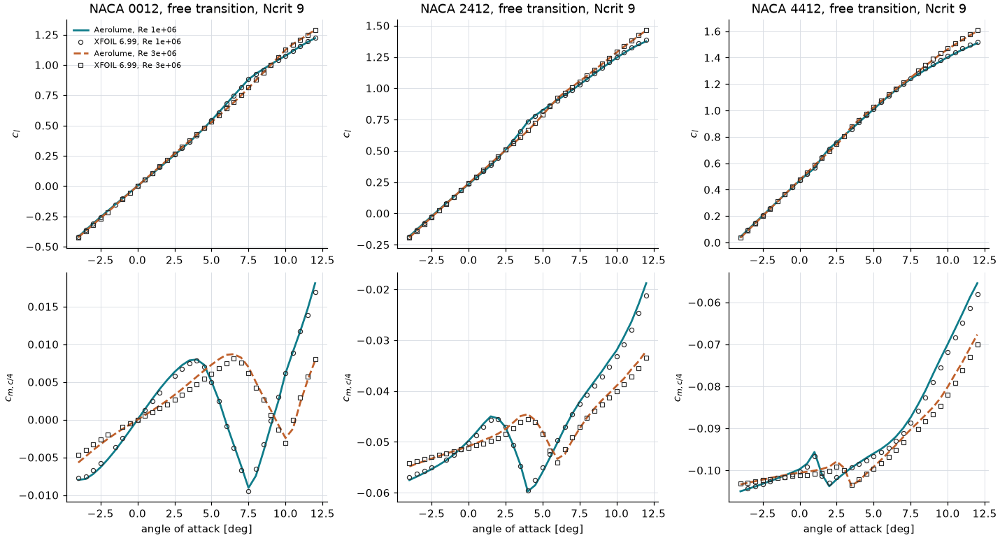
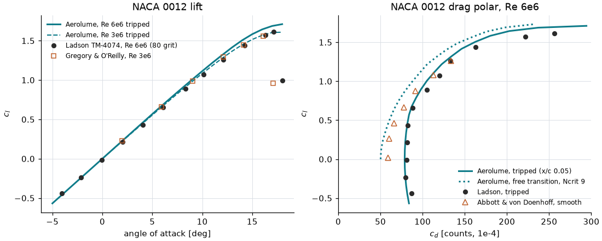
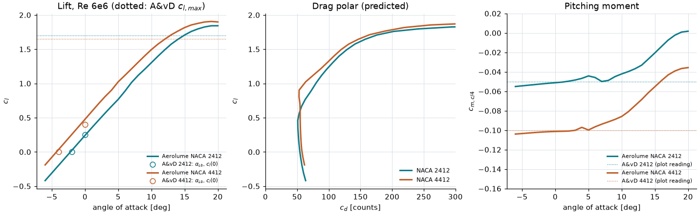
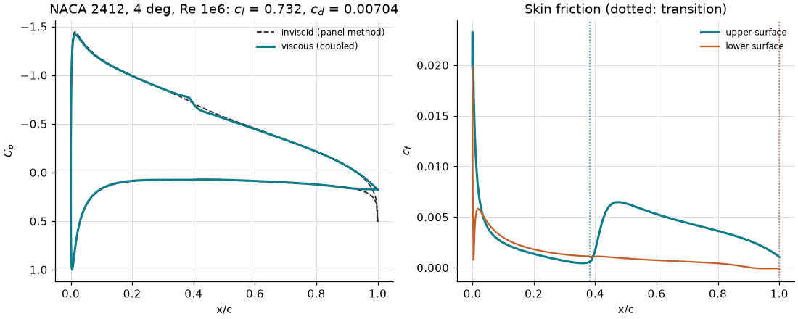

# Airfoil polar solver: validation

This page compares Aerolume's viscous–inviscid airfoil analysis (the **Polar** analysis; method in
[theory_airfoil.md](theory_airfoil.md)) with wind-tunnel data for NACA 0012, 2412 and 4412.
Everything here is regenerated by

```
python validation/airfoil_validation.py
```

which prints the tables below and renders the figures to `docs/img/airfoil_*.png`. The same cases
and reference values are asserted in `tests/test_airfoil_validation.py`
(`pytest tests/test_airfoil_validation.py -m slow`); the XFOIL cross-check is asserted in
`tests/test_airfoil_polar_regularity.py`. Numbers below are from the run of 2026-10-05 (199 panels,
Ncrit = 9; all points converged).

## Reference data

Only the values that are compared were transcribed (see the docstring of the validation script).

| Data set | Conditions | Source |
|---|---|---|
| NACA 0012 cl, cd | Re 6×10⁶, M 0.15, transition tripped (80-grit) | C. L. Ladson, NASA TM-4074 (1988), tabulated; via the NASA Turbulence Modeling Resource |
| NACA 0012 cl | Re 3×10⁶, tripped | D. Gregory, C. L. O'Reilly, ARC R&M 3726 (1970); digitised from the report's plot by the NASA TMR (≈ ±0.01) |
| NACA 0012 cl, cd–cl | Re 6×10⁶, smooth model (free transition) | Abbott & von Doenhoff, *Theory of Wing Sections*, App. IV; digitised by the NASA TMR ("digitizing only approximate") |
| NACA 2412, 4412: α_L0, cl(0), cl,max, cm | Re ≈ 6×10⁶, smooth | Abbott & von Doenhoff App. IV plots, as read in Marchman, *Aerodynamics and Aircraft Performance* (App.), and Anderson, *Fundamentals of Aerodynamics*. Plot readings: ±0.3°, ±0.03 in cl, ±0.01 in cm |
| NACA 0012, 2412, 4412: cl, cd, cm, transition | Re 1×10⁶ and 3×10⁶, free transition, Ncrit 9, −4…12° in 0.5° steps | XFOIL 6.99 (M. Drela, MIT), run on the identical coordinates; code-to-code reference, not experiment |

Modelling of the tests: tripped cases force transition at x/c = 0.05 on both surfaces (the trip
location is our assumption: grit strips sit near the leading edge); free-transition cases use
Ncrit = 9; Ladson's Mach 0.15 is included (Kármán–Tsien).

## Cross-check against XFOIL 6.99

Wind-tunnel data tell whether the *model* is right; XFOIL tells whether the *implementation*
reproduces the model. XFOIL 6.99 was run on exactly the coordinates the viscous solver analyses
(`naca4(code, 200)` after `prepare_coords`, trailing edge opened to 0.05 % c), 200 nodes, Ncrit 9,
free transition; the reference values are stored in the validation script (`XFOIL_REF`, regenerate
with `--xfoil PATH`). Angles where XFOIL itself did not converge (1–3 per polar) are left out.



| Section | Re | angles compared | max \|Δcl\| | max \|Δcm\| | max \|Δcd\| | max \|Δ(dcl/dα)\| per 0.5° | unconverged |
|---|---|---:|---:|---:|---:|---:|---:|
| 0012 | 10⁶ | 30 | 0.0054 | 0.0012 | 1.7 % | 0.013 /deg | 0 of 33 |
| 0012 | 3×10⁶ | 32 | 0.0062 | 0.0012 | 1.4 % | 0.018 /deg | 0 of 33 |
| 2412 | 10⁶ | 32 | 0.0116 | 0.0024 | 1.7 % | 0.009 /deg | 0 of 33 |
| 2412 | 3×10⁶ | 33 | 0.0059 | 0.0014 | 2.0 % | 0.014 /deg | 0 of 33 |
| 4412 | 10⁶ | 30 | 0.0121 | 0.0026 | 2.4 % | 0.011 /deg | 0 of 33 |
| 4412 | 3×10⁶ | 32 | 0.0104 | 0.0023 | 1.7 % | 0.007 /deg | 0 of 33 |

The largest differences are at 10–12°, where they grow smoothly with angle (Aerolume's lift is up to
0.012 lower and its moment less nose-down; the wake and trailing-edge treatments of mfoil and XFOIL
differ in detail). Below 8° (1° steps) Cl agrees to 0.006 and the lower-surface transition location
to 0.004 x/c.

**The kink in the lift curve is the model, not a bug.** Every polar above has a stretch where the
lift slope rises by 20–50 % and Cm turns nose-down by 0.005–0.015, followed by a lower slope: it
happens where the pressure-side transition point runs off the trailing edge (at Re 10⁶: NACA 0012
4–8°, 2412 2–4.5°, 4412 1–2°; at 3×10⁶ about 2° later), and XFOIL shows it at the same angles with
the same size.
Just before the transition point leaves the surface, the laminar boundary layer ahead of it
separates a few per cent of chord before the trailing edge (shape factor H rises to 6–7), and its
displacement thickness acts as extra aft camber (theory_airfoil.md, section 5). NACA 2412, Re 10⁶:

| α [deg] | cl XFOIL | cl | cm XFOIL | cm | cd XFOIL | cd | lower xtr XFOIL | lower xtr |
|---:|---:|---:|---:|---:|---:|---:|---:|---:|
| −1 | 0.1328 | 0.1326 | −0.0525 | −0.0525 | 0.00594 | 0.00593 | 0.480 | 0.481 |
| 0 | 0.2347 | 0.2329 | −0.0502 | −0.0498 | 0.00555 | 0.00555 | 0.682 | 0.681 |
| 1 | 0.3351 | 0.3323 | −0.0471 | −0.0465 | 0.00541 | 0.00539 | 0.852 | 0.852 |
| 2 | 0.4440 | 0.4430 | −0.0456 | −0.0454 | 0.00573 | 0.00573 | 0.956 | 0.955 |
| 3 | 0.5797 | 0.5795 | −0.0506 | −0.0505 | 0.00634 | 0.00634 | 0.988 | 0.986 |
| 4 | 0.7316 | 0.7324 | −0.0596 | −0.0597 | 0.00704 | 0.00704 | 1.000 | 0.999 |
| 5 | 0.8196 | 0.8239 | −0.0550 | −0.0559 | 0.00797 | 0.00797 | 1.000 | 1.000 |
| 6 | 0.9029 | 0.9052 | −0.0497 | −0.0502 | 0.00931 | 0.00930 | 1.000 | 1.000 |
| 8 | 1.0749 | 1.0723 | −0.0407 | −0.0401 | 0.01240 | 0.01232 | 1.000 | 1.000 |
| 10 | 1.2488 | 1.2440 | −0.0332 | −0.0320 | 0.01571 | 0.01550 | 1.000 | 1.000 |

How it was ruled out as a numerical artefact (2026-10-05): (1) the pristine `third_party/mfoil`
run cold at each angle on its own NACA 2412 geometry gives Cl 0.4494 / 0.7191 / 0.9024 at 2 / 4 / 6°,
identical to Aerolume's sweep on that geometry to four digits, so neither the warm starts nor the
vectorised kernels in `_fast.py` cause it; (2) cold single-angle solves at 3, 4 and 5° equal the
warm-started sweep values; (3) XFOIL agrees as shown. Below the run-off the slope is nearly
constant (0.099–0.110 /deg over −4…1° for all six polars); above it, it is lower (0.08–0.09 /deg)
and falls as the upper-surface transition moves forward. Whether a real section shows the kink this
strongly depends on the tunnel's disturbance level, which Ncrit only approximates; no wind-tunnel
data at Re 1–3×10⁶ were available here to check its size. The polar's notes name the angles where it
occurs, so users do not mistake it for a convergence failure.

`tests/test_airfoil_polar_regularity.py` pins this: Cl, Cm, Cd and the 1°-interval lift slopes of all
six polars against XFOIL (tolerances 0.02, 0.004, 3.5 %, 0.015 /deg), a near-constant slope
(±15 % of the median, median 0.095–0.115 /deg) below the run-off, no Cm step above 0.012 per degree,
cold start = sweep in the kink, and the note.

**Known issue outside the solver: NACA sections created as a Design are rotated slightly.**
`design_from_airfoil` re-chords the outline through the nose point farthest from the trailing edge
(found on a spline), which for a cambered NACA section is not the published chord line's origin:
NACA 2412 is turned 0.09° nose-down (camber at mid-chord 0.0187 instead of 0.0195) and 4412 0.18°.
A polar of such a Design therefore reads about 0.01 (2412) to 0.02 (4412) lower in Cl than XFOIL or
NACA data at the same nominal angle (NACA 2412, Re 10⁶, 0°: 0.2239 from the Design vs 0.2329 from the
coordinates). The polar solver keeps the frame it is given (`prepare_coords` keeps a Design's chord
line so polar and CFD angles agree), so the fix belongs in the geometry module.



## NACA 0012, Re 6×10⁶, tripped — Ladson (NASA TM-4074)

| α [deg] | cl exp | cl calc | Δcl | cd exp | cd calc | Δcd |
|---:|---:|---:|---:|---:|---:|---:|
| −4.04 | −0.4417 | −0.4590 | −0.017 | 0.00871 | 0.00820 | −6 % |
| −2.14 | −0.2385 | −0.2434 | −0.005 | 0.00800 | 0.00796 | −0 % |
| −0.05 | −0.0126 | −0.0057 | +0.007 | 0.00809 | 0.00787 | −3 % |
| 2.05 | 0.2125 | 0.2332 | +0.021 | 0.00816 | 0.00796 | −2 % |
| 4.04 | 0.4316 | 0.4590 | +0.027 | 0.00823 | 0.00820 | −0 % |
| 6.09 | 0.6546 | 0.6895 | +0.035 | 0.00885 | 0.00876 | −1 % |
| 8.30 | 0.8873 | 0.9316 | +0.044 | 0.01050 | 0.01004 | −4 % |
| 10.12 | 1.0707 | 1.1259 | +0.055 | 0.01201 | 0.01147 | −4 % |
| 12.12 | 1.2605 | 1.3305 | +0.070 | 0.01332 | 0.01356 | +2 % |
| 14.22 | 1.4365 | 1.5228 | +0.086 | 0.01625 | 0.01665 | +2 % |
| 16.30 | 1.5739 | 1.6571 | +0.083 | 0.02218 | 0.02131 | −4 % |
| 17.13 | 1.6116 | 1.6905 | +0.079 | 0.02560 | 0.02445 | −4 % |

* **Drag: within 6 % at every pre-stall angle** (−4° to 17°).
* **Lift: within 0.05 up to 8°**, but the computed lift slope is high: 0.113/deg against
  Ladson's 0.108/deg over −4…8°, so the difference grows to +0.08 at 14–17°. Separating the
  effects with extra runs at 0/4/8°: the Mach 0.15 correction accounts for +1.5 % (0.1107/deg at
  M = 0), and at Re 3×10⁶, M = 0 the slope is 0.1097/deg against ~0.107/deg in Gregory &
  O'Reilly's data. The method's linear-range lift slope is therefore **2–4 % above both
  experiments** (a slight lift over-prediction is commonly reported for XFOIL-type methods; the
  tunnel data also carry wall-correction uncertainty).
* **Stall: not captured.** Ladson's section stalls abruptly between 17.1° and 18.0°
  (cl 1.61 → 1.00); the computed cl keeps rising to 1.71 at 18°.

## NACA 0012, Re 3×10⁶, tripped — Gregory & O'Reilly (R&M 3726)

| α [deg] | cl exp | cl calc | Δcl |
|---:|---:|---:|---:|
| 1.97 | 0.231 | 0.219 | −0.012 |
| 5.94 | 0.658 | 0.658 | +0.000 |
| 9.04 | 0.985 | 0.986 | +0.001 |
| 12.13 | 1.293 | 1.289 | −0.004 |
| 14.13 | 1.447 | 1.457 | +0.010 |
| 16.10 | 1.561 | 1.573 | +0.012 |

Computed cl,max 1.608 at 18° (end of the sweep) versus ~1.56 at 16.1° before the measured stall.
The good point-wise agreement at 6–16° partly reflects an offset in the digitised data (cl = 0.026
at α = 0.09°): the slope difference noted above is still there.

## NACA 0012, Re 6×10⁶, free transition — Abbott & von Doenhoff (smooth model)

| α [deg] | cl exp | cl calc | Δcl |
|---:|---:|---:|---:|
| 1.97 | 0.216 | 0.213 | −0.003 |
| 4.88 | 0.552 | 0.526 | −0.026 |
| 7.96 | 0.871 | 0.856 | −0.015 |
| 10.19 | 1.121 | 1.121 | −0.000 |
| 13.11 | 1.363 | 1.411 | +0.048 |
| 16.38 | 1.596 | 1.658 | +0.062 |

| cl | cd exp | cd calc | Δcd |
|---:|---:|---:|---:|
| 0.021 | 0.00593 | 0.00503 | −15 % |
| 0.263 | 0.00601 | 0.00535 | −11 % |
| 0.462 | 0.00660 | 0.00594 | −10 % |
| 0.662 | 0.00779 | 0.00672 | −14 % |
| 0.878 | 0.00916 | 0.00794 | −13 % |
| 1.079 | 0.01130 | 0.00943 | −17 % |
| 1.261 | 0.01335 | 0.01104 | −17 % |

With free transition the drag is **under-predicted by 10–17 %**. The shape of the drag polar is
right, the level is low: Ncrit = 9 lets the boundary layer stay laminar longer than it did on the
NACA model in the low-turbulence tunnel (Ncrit is a property of the tunnel, not of the airfoil; a
lower Ncrit moves the curve towards the data), and the digitised book values carry their own
uncertainty. The tripped polar (previous figure, right) brackets the data from the other side —
the practical advice in theory_airfoil.md (run free *and* tripped) is based on this.

## NACA 2412 and 4412, Re 6×10⁶, free transition — Abbott & von Doenhoff



| Section | Quantity | A&vD (plot reading) | Aerolume |
|---|---|---:|---:|
| 2412 | zero-lift angle | −2.0° | −2.24° |
| 2412 | cl at 0° | 0.25 | 0.241 |
| 2412 | lift slope (−2…6°) | ~0.105 /deg | 0.1073 /deg |
| 2412 | cl,max (α) | ~1.7 | 1.843 (20°, no stall within the sweep) |
| 2412 | cm,c/4 (0–4°) | −0.05 | −0.049 |
| 2412 | cd at cl 0.4 / 0.8 | — | 0.00511 / 0.00653 |
| 4412 | zero-lift angle | −4.0° | −4.39° |
| 4412 | cl at 0° | ~0.40 | 0.477 |
| 4412 | lift slope (−2…6°) | ~0.105 /deg | 0.1084 /deg |
| 4412 | cl,max (α) | ~1.65 | 1.906 (19°) |
| 4412 | cm,c/4 (0–4°) | −0.10 | −0.100 |
| 4412 | cd at cl 0.4 / 0.8 | — | 0.00550 / 0.00531 |

* Zero-lift angle, lift slope and **pitching moment agree** (cm within 0.001 of the readings).
* **NACA 4412 lift is high by ~0.07** (cl at 0°: 0.477 vs ~0.40; zero-lift angle 0.4° more
  negative). This is panel-converged (0.476 / 0.477 / 0.478 at 159 / 199 / 299 panels), so it is
  the model's behaviour rather than a discretisation error; together with the 2–4 % slope excess
  seen on the 0012 it suggests the viscous decambering at the trailing edge is under-predicted,
  more so on the more cambered section (not investigated further). It **exceeds the 0.05 target**
  and is listed as a known deviation; the test pins it at < 0.09.
* **cl,max is over-predicted** by ~0.15 (2412) and ~0.25 (4412) and stall comes several degrees late
  — the expected weakness of XFOIL-class methods near stall (theory_airfoil.md, section 5).
* Drag for the cambered sections was not compared: no authoritative tabulated values were
  available to transcribe. The computed values (0.0051–0.0065 in the drag bucket) are of the
  expected magnitude for smooth 12 %-thick sections at this Reynolds number, and the 0012 results
  above indicate the likely error (−10…−17 % free, ±6 % tripped).
* The kinks in cl and cm near 4–7° are where the lower-surface transition point runs off the trailing
  edge (edge of the drag bucket); XFOIL predicts the same (see the XFOIL cross-check above).

## Surface distributions



NACA 2412 at 4°, Re 10⁶: the boundary layer reduces the suction and the trailing-edge loading
relative to the inviscid panel solution; the laminar separation bubble ahead of upper-surface
transition (x/c ≈ 0.38) shows as the plateau in Cp and the near-zero Cf just upstream of the jump.

## Performance

Reference case: NACA 2412, Re 10⁶, 19 angles (−4° to 14°, 1° steps), 199 panels, single
process, `OPENBLAS_NUM_THREADS=2`, on the development machine (another heavy process was running):
**14.2 s, 19/19 converged** (12.5 s in an earlier run) (target: ~15 s). The validation polars above took 14–20 s for 19–24
angles at Re 3–6×10⁶ and 43–53 s for the 27-angle cambered sweeps, which include the deep
post-maximum angles where Newton needs many more iterations.

Single inviscid solutions take ~0.1–0.2 s (paneling plus one dense solve).

## Convergence robustness

All 117 wind-tunnel validation points and all 198 XFOIL cross-check points converged. During this work three upstream robustness problems were
found and fixed (patches P11, P12 in the vendored mfoil and the line search / engineering-tolerance
acceptance in `solver.py`, see theory_airfoil.md section 4): before them, the same sweeps lost
3–4 points per polar at Re 6–9×10⁶ (e.g. NACA 2412 at 0°, 6°, 8°, 10°). A few free-transition
points are accepted at "engineering tolerance" (Newton residual cycling at ~10⁻² while Cl and Cd
vary by less than 0.002 and 1 %); the polar result lists them in its notes.

## Summary against the quality bar

| Check | Target | Result |
|---|---|---|
| Cl, NACA 0012, 0–8°, vs Ladson / Gregory / A&vD | within 0.05 | max 0.044 / 0.012 / 0.026 ✔ |
| Cd, NACA 0012 tripped, attached (−4…10°) vs Ladson | within 15–20 % | max 6 % ✔ |
| Cd, NACA 0012 free transition vs A&vD (cl ≤ 0.9) | within 20 % | max 15 % (low) ✔ |
| NACA 2412 zero-lift angle / cl(0) / cm | — | −2.24° / 0.241 / −0.049 vs −2.0° / 0.25 / −0.05 ✔ |
| NACA 4412 zero-lift angle / cl(0) / cm | — | −4.39° / 0.477 / −0.100 vs −4.0° / ~0.40 / −0.10 — **cl high by 0.077** ✘ |
| cl,max region | — | over-predicted by 0.1 (0012) to 0.25 (4412); stall late ✘ (documented limit) |
| 19-point polar, NACA 2412, Re 10⁶ | < ~15 s | 14.2 s ✔ |
| Cl / Cm / Cd vs XFOIL 6.99, identical geometry, 6 polars | — | max 0.012 / 0.0026 / 2.4 %, kink reproduced ✔ |
