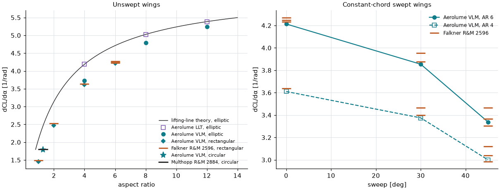
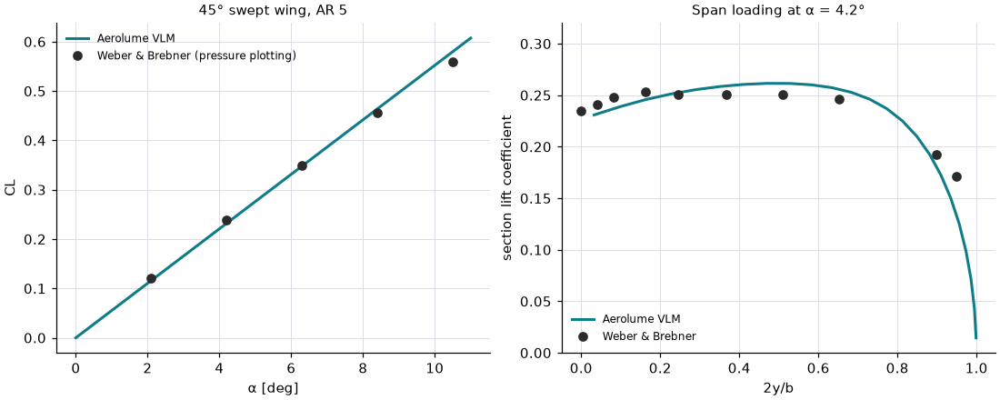
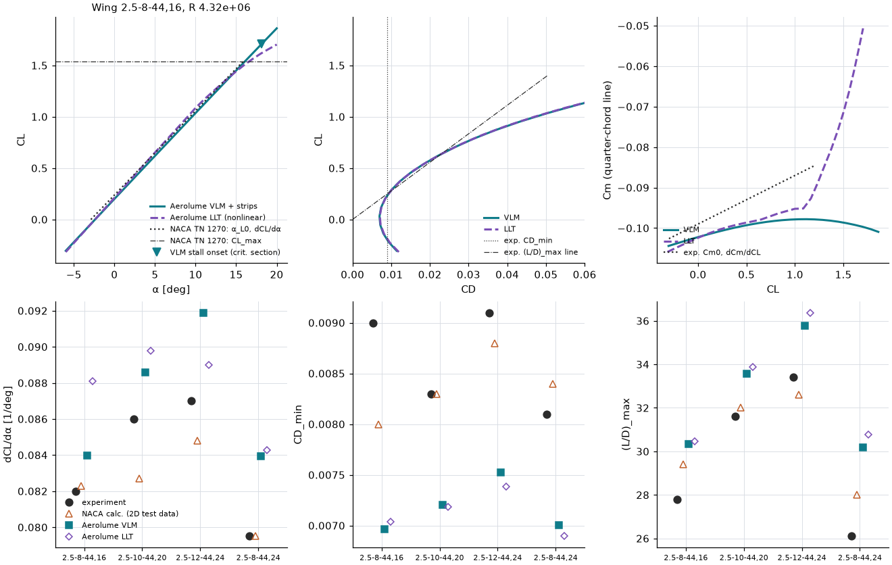

# Finite-wing analysis: validation

This page checks Aerolume's **Wing** analysis (vortex lattice and nonlinear lifting line with
viscous strip coupling; method in [theory_wing.md](theory_wing.md)) against lifting-line theory,
published lifting-surface solutions, two wind-tunnel data sets and a textbook lattice. Everything is
regenerated by

```
python validation/wing_validation.py [--cache DIR] [--ncrit-sensitivity 5]
```

which prints the tables below and renders `docs/img/wing_*.png`. The same cases, reference values and
tolerances (`TOL`) are asserted in `tests/test_wing_validation.py` (inviscid cases in the fast suite,
the viscous wings and the timing with `-m slow`). Numbers below are from the runs of 2026-10-06
(defaults: 8 chordwise × 24 spanwise panels per half, cosine spacing).

## Summary

| Check | Target | Result |
|---|---|---|
| Elliptic wing, AR 4/8/12: CLα vs 2πAR/(AR+2) | within 2 % | **LLT: +0.0 %** ✔; VLM: −10.9 / −4.7 / −2.7 % — the lifting-surface correction, see below |
| Elliptic wing: span efficiency e | ≥ 0.98 | VLM 0.997 / 0.998 / 0.999, LLT 1.000 ✔ |
| Circular wing (lifting surface, Multhopp R&M 2884) | — | 1.793 vs 1.799 /rad (−0.3 %) ✔ |
| Rectangular AR 6 (Falkner R&M 2596, lifting surface) | — | 4.213 vs 4.231–4.270 (−0.4 … −1.3 %) ✔; LLT 4.530 vs Falkner's lifting line 4.527 ✔ |
| Rectangular AR 4 / 2 / 1 (Falkner) | — | −0.8 / −2.0 / −2.0 % ✔ |
| Swept constant-chord wings, AR 4 and 6, 30° and 45° (Falkner) | within 5 % | inside Falkner's range of solutions or ≤ 0.7 % below it ✔ |
| 45° swept wing AR 5, CL vs Weber & Brebner (wind tunnel, 2.1–10.5°) | within 5 % | −3.2 … +3.9 % ✔ |
| same, section lift at 4.2°, 0.04 ≤ 2y/b ≤ 0.9 | — | within ±0.011 ✔ (−0.037 at 2y/b = 0.95) |
| Bertin & Smith lattice (4 horseshoes/semispan) | — | 3.4440 vs 3.443 /rad ✔ (identical discretisation) |
| Viscous wings, NACA TN 1270 (4 wings): dCL/dα | — | VLM +2.4 … +5.6 %, LLT +2.3 … +7.4 % |
| … α_L0 | — | within 0.52° (linear washout assumed) |
| … CD_min | — | **13–22 % low** (free transition, Ncrit 9) |
| … (L/D)_max | — | 6–18 % high (follows from the drag) |
| … Cm at zero lift | — | VLM within 0.018, LLT within 0.009 |
| … CL_max | — | **not validated**: critical-section estimate 0.17–0.31 high (section polars stall late) |
| 17-point viscous VLM polar, 2-section wing (one airfoil), cold cache | < ~30 s | **23.4 s** (22.0 s in an earlier run) ✔; warm 0.38 s |
| same with two different airfoils (root 2412, tip 0012), cold | — | 52.8 s ✘ (twice the section polars); warm 0.52 s |

## 1. Elliptic wings: lifting-line theory

Flat elliptic planforms with a straight quarter-chord line, inviscid, α = 2° (VLM) and 3–4° (LLT).

| AR | 2πAR/(AR+2) | LLT | Δ | e (LLT) | VLM | Δ | e (VLM) |
|---:|---:|---:|---:|---:|---:|---:|---:|
| 4 | 4.1888 | 4.1900 | +0.0 % | 1.0000 | 3.7334 | −10.9 % | 0.9973 |
| 8 | 5.0265 | 5.0274 | +0.0 % | 1.0000 | 4.7894 | −4.7 % | 0.9983 |
| 12 | 5.3856 | 5.3862 | +0.0 % | 1.0000 | 5.2413 | −2.7 % | 0.9989 |

The lifting line reproduces Prandtl's result to 0.05 % with e = 1.0000. **The vortex lattice does
not, and should not:** 2πAR/(AR+2) is lifting-*line* theory, which ignores the chordwise extent of the
loading; a lifting *surface* carries less lift at low aspect ratio (Helmbold's approximation gives
−7 % at AR 4). That the lattice's lower values are the right ones is shown by the lifting-surface
references of section 2 — above all the circular wing, whose AR (1.27) is the hardest case and
where the lattice matches Multhopp's lifting-surface solution to 0.3 %. The DESIGN.md bar "CLα =
2πAR/(AR+2) within 2 %" is therefore met by the LLT; for the VLM it holds only at high AR (−2.7 % at
AR 12, tending to 0 as AR grows). Both methods keep e ≥ 0.997.

The semicircle collocation (theory_wing.md §1) is what makes e ≈ 1 at practical panel counts: with
control points at the strip y-midpoints instead, the elliptic AR 4 wing gave e = 1.053 / 1.025 /
1.012 at 12 / 24 / 48 panels per half (first-order convergence); with them e = 0.997–0.998 for all
three, and CLα changes by less than 0.1 % between 12 and 96 panels.



## 2. Lifting-surface references

Inviscid flat wings; reference values are dCL/dα per radian from H. Multhopp, ARC R&M 2884 (circular
wing) and V. M. Falkner, ARC R&M 2596 (Tables 5–34: 84- and 126-vortex lattices with 6–9 control
points, "standard" and "modified" solutions; Falkner notes that his 126-vortex values may need a
factor 1 + 0.029 tan Λ, so they carry ~1–3 % uncertainty themselves).

| wing | reference | Aerolume | Δ |
|---|---:|---:|---:|
| circular (AR 1.27) | 1.799 (Multhopp) | 1.7930 | −0.3 % |
| rectangular AR 6 | 4.270 / 4.247 / 4.231 | 4.2132 | −0.9 % (to the mean) |
| rectangular AR 4 | 3.639 | 3.6105 | −0.8 % |
| rectangular AR 2 | 2.524 | 2.4728 | −2.0 % |
| rectangular AR 1 | 1.489 | 1.4591 | −2.0 % |
| rectangular AR 6, **LLT** | 4.527 (Falkner's lifting line) | 4.5301 | +0.1 % |
| AR 6, 30° sweep | 3.955 / 3.877 | 3.8540 | 0.6 % below the range |
| AR 6, 45° sweep | 3.464 / 3.367 / 3.304 / 3.365 | 3.3384 | inside |
| AR 4, 30° sweep | 3.467 / 3.400 | 3.3750 | 0.7 % below |
| AR 4, 45° sweep | 3.121 / 3.039 / 2.986 | 3.0001 | inside |

The lattice converges to these values with the default panelling (24 vs 48 spanwise and 8 vs 16
chordwise panels change them by < 0.25 %). Span efficiency of the 45° wings (0.885 at AR 6) also falls
inside Falkner's range (induced-drag factors 1.107–1.157, i.e. e = 0.86–0.90).

## 3. 45° swept wing — Weber & Brebner (wind tunnel)

J. Weber, G. G. Brebner, ARC R&M 2882: constant chord, AR 5, 45° sweep, RAE 101 (12 %) section,
Re 1.7×10⁶; lift from pressure plotting (Table 4B) and section lift at α = 4.2° (Table 3), as
transcribed in the FLOWPanel.jl example `liftingline_weber.jl`. Compared with the inviscid lattice
(the viscous coupling does not change the lattice's lift).

| α [deg] | CL exp | CL VLM | Δ |
|---:|---:|---:|---:|
| 2.1 | 0.121 | 0.117 | −3.2 % |
| 4.2 | 0.238 | 0.234 | −1.7 % |
| 6.3 | 0.350 | 0.350 | +0.1 % |
| 8.4 | 0.456 | 0.466 | +2.2 % |
| 10.5 | 0.559 | 0.581 | +3.9 % |

| 2y/b | 0 | 0.041 | 0.082 | 0.163 | 0.245 | 0.367 | 0.510 | 0.653 | 0.898 | 0.949 |
|---|---:|---:|---:|---:|---:|---:|---:|---:|---:|---:|
| cl exp (4.2°) | 0.235 | 0.241 | 0.248 | 0.253 | 0.251 | 0.251 | 0.251 | 0.246 | 0.192 | 0.171 |
| cl VLM | 0.231 | 0.232 | 0.237 | 0.246 | 0.252 | 0.259 | 0.261 | 0.256 | 0.181 | 0.134 |

The measured lift curve bends over slightly (0.0576/deg at 2.1°, 0.0532/deg at 10.5°: viscous effects
on the swept, 12 % thick wing) while the lattice is linear (CLα = 3.164/rad over the range), so the
difference moves from −3 % to +4 %. The span loading matches within ±0.011 over 4–90 % of the span,
including the reduced loading at the centre of a swept wing; at 95 % of the span the measurement is
0.037 higher — the suction of the tip vortex rolling up over the upper surface, which a flat wake
does not model (theory_wing.md §6).



**Code-to-code check.** Bertin & Smith's worked VLM example for the same planform (4 horseshoe
vortices per semispan, 1 chordwise, uniform spacing) gives CLα = 3.443/rad (as quoted by T. Melin,
"A vortex lattice MATLAB implementation…", KTH 2000); Aerolume with the identical lattice gives
3.4440/rad. The four strip circulations are 0.0250, 0.0286, 0.0287, 0.0273 × 4πbV∞α from tip to root.

## 4. Viscous wings — NACA TN 1270 (wind tunnel)

R. H. Neely, T. V. Bollech, G. C. Westrick, R. R. Graham, NACA TN 1270 (1947): unswept tapered wings
(taper 2.5, AR 8–12, NACA 44-series sections from 4416–4424 at the root to 4412 at the tip, 2.4–4.5°
washout, parabolic tips over the outer 5 % of the semispan) tested smooth in the Langley 19-ft
pressure tunnel at R = 2.9–4.3×10⁶ (Mach ≈ 0.13). Table I gives the geometry and Table II the
experimental characteristics compared here, together with NACA's own lifting-line calculation from
**measured** 2D section data (the "generalized method"). XFLR5's guidelines validate against the same
report. Only the four wings with integer NACA thicknesses were run.

Modelling choices (the report does not give them all): planform area matched to Table I (MAC then
agrees to 0.75 %), the parabolic tip as a chord falling parabolically to zero, **linear washout**,
thickness interpolated from the root to the 4412 at 95 % semispan, Mach 0.13 (estimated from the
stated tunnel density and Re), free transition with **Ncrit 9**, moments about the (unswept)
quarter-chord line, α from −6° to 20° in 1° steps. All 27 points converged for every wing and method.

| wing | quantity | experiment | NACA calc. | VLM | LLT |
|---|---|---:|---:|---:|---:|
| 2.5-8-44,16 (R 4.32e6) | dCL/dα [/deg] | 0.0820 | 0.0823 | 0.0840 | 0.0881 |
| | α_L0 [deg] | −2.90 | −2.90 | −2.38 | −2.40 |
| | CD_min | 0.0090 | 0.0080 | 0.0070 | 0.0070 |
| | (L/D)_max | 27.8 | 29.4 | 30.3 | 30.5 |
| | Cm at CL = 0 | −0.099 | −0.093 | −0.102 | −0.102 |
| | dCm/dCL | 0.012 | 0.007 | 0.006 | 0.008 |
| | CL_max | 1.54 | 1.48 | 1.71 (18.2°) | — |
| 2.5-10-44,20 (R 3.49e6) | dCL/dα | 0.0860 | 0.0827 | 0.0886 | 0.0898 |
| | α_L0 | −3.20 | −3.00 | −2.83 | −2.79 |
| | CD_min | 0.0083 | 0.0083 | 0.0072 | 0.0072 |
| | (L/D)_max | 31.6 | 32.0 | 33.6 | 33.9 |
| | Cm at CL = 0 | −0.095 | −0.087 | −0.103 | −0.099 |
| | CL_max | 1.43 | 1.41 | 1.63 (15.7°) | — |
| 2.5-12-44,24 (R 2.87e6) | dCL/dα | 0.0870 | 0.0848 | 0.0919 | 0.0890 |
| | α_L0 | −3.20 | −3.00 | −3.08 | −2.84 |
| | CD_min | 0.0091 | 0.0088 | 0.0075 | 0.0074 |
| | (L/D)_max | 33.4 | 32.6 | 35.8 | 36.4 |
| | Cm at CL = 0 | −0.097 | −0.085 | −0.103 | −0.092 |
| | CL_max | 1.27 | 1.31 | 1.58 (14.3°) | — |
| 2.5-8-44,24 (R 4.32e6) | dCL/dα | 0.0795 | 0.0795 | 0.0839 | 0.0843 |
| | α_L0 | −3.20 | −3.10 | −3.36 | −3.10 |
| | CD_min | 0.0081 | 0.0084 | 0.0070 | 0.0069 |
| | (L/D)_max | 26.1 | 28.0 | 30.2 | 30.8 |
| | Cm at CL = 0 | −0.084 | −0.083 | −0.102 | −0.093 |
| | CL_max | 1.37 | 1.35 | 1.64 (16.3°) | — |

(dCL/dα and α_L0 from a straight-line fit over −4…4°; CD_min the minimum over the 1° sweep; Cm and
dCm/dCL at zero lift; CL_max the critical-section stall onset of theory_wing.md §5, "—" when no strip
away from the tips reached its section cl_max by 20°, where the LLT's CL was 1.65–1.70.)



What this shows:

* **Lift slope.** VLM +2.4 … +5.6 %, growing with root thickness (16 → 24 %): the lattice's lift is
  that of the thin mean surface, while thick sections lose lift slope to the boundary layer. The LLT
  takes the viscous section slopes but has no chordwise loading, which over-predicts the slope at
  low AR (+7.4 % at AR 8, +2.3 % at AR 12). NACA's calculation added the Jones edge-velocity
  correction to its lifting line and was within 4 %.
* **Zero-lift angle** within 0.52°. The two AR-8 wings differ only in washout (4.5° vs 2.4°) and
  root section, and the error shrinks with the washout (+0.52° → −0.16° VLM, +0.50° → +0.10° LLT):
  consistent with the assumed linear twist distribution being wrong (the report gives only the tip
  value), not with a solver bias.
* **Profile drag is 13–22 % low** (both methods: it is the same strip drag). The section solver's
  free-transition drag at Ncrit 9 is itself low (docs/validation_airfoil.md: up to −15 % against
  Abbott & von Doenhoff), and the 19-ft pressure tunnel is a more disturbed environment than the
  low-turbulence tunnels Ncrit 9 represents. With **Ncrit 5** the 2.5-8-44,16 wing gives CD_min
  0.0075 (−17 %) and (L/D)_max 29.3 (+5 %) — closer, but Ncrit is not a calibration knob and the
  table keeps the default. NACA's calculation with measured section data was 11 % low on this
  wing too, so part of the gap is in the 3D test itself (support tare and interference corrections,
  the report discusses this).
* **(L/D)_max 6–18 % high**, as a direct consequence of the drag.
* **Pitching moment at zero lift**: the LLT, which takes cm from the viscous polars, is within 0.009;
  the lattice's cm is the inviscid camber moment (−0.102 for every 44-series wing) and misses the
  thick root sections' viscous decambering (−0.084 measured on 2.5-8-44,24: 0.018 off).
* **CL_max is not validated.** The section polars stall late and high (validation_airfoil.md: cl_max
  over-predicted by 0.1–0.25 for 4-digit sections), so the critical-section estimate of the lattice is
  0.17–0.31 high, and the LLT's sections had not reached their cl_max by α = 20°. Treat Aerolume's
  stall onset as optimistic; use CFD or test data for maximum lift.

## 5. Performance

Two-section tapered wing (span 2 m, chords 0.30 / 0.15 m, 20 m/s → strip Re 2.1–4.0×10⁵),
17 angles (−4° to 12°), viscous VLM, 8 × 48 panels, single process, `OPENBLAS_NUM_THREADS=2`, on the
development machine **while other agents' GPU and CPU jobs were running** (shared machine):

| case | cold (empty polar cache) | section points | warm | inviscid |
|---|---:|---:|---:|---:|
| NACA 2412 root and tip | **23.4 s** (22.0 s in a second run) | 42 (2 Re × 21 α) | 0.38 s | 0.44 s |
| NACA 2412 root, 0012 tip | 52.8 s (50.1 s) | 84 | 0.52 s | 0.42 s |

The cost is the 2D section polars (≈0.55 s per point here), which is why `SectionPolars` places as
few Reynolds nodes as the interpolation allows and computes only the angles the wing needs; a
two-airfoil wing needs twice the polars and misses the ~30 s target. Running polars in parallel
processes would roughly halve it; not done (threads do not help: measured 13.4 s serial vs 15.1 s
with two threads for two polars, the solver holds the GIL). The NACA TN 1270 wings (2 airfoils,
3 Re nodes each, VLM and LLT sweeps to 20° with polars extended to stall) took 6–7 minutes each from
an empty cache in the slow test run, mostly in section points near and beyond stall, where the 2D
solver needs several retries; the same run measured the 17-point target case at 21.6 s.

## What was not verified

* Sideslip: signs, antisymmetry and the dihedral effect's direction are unit-tested
  (`tests/test_wing_solver.py`), but no lateral-derivative data were compared.
* Compressibility: the Prandtl–Glauert implementation is tested against Göthert's rule (exact
  identity with the stretched incompressible wing), not against compressible test data.
* Twisted, cranked or multi-airfoil wings beyond the NACA TN 1270 set; wings with dihedral (only the
  kinematics are tested); low Reynolds numbers (< 2×10⁵) against data.
